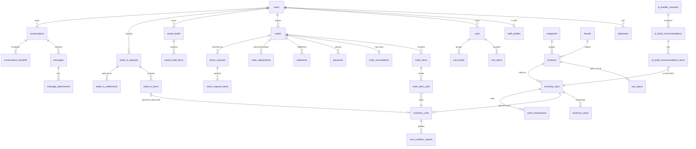
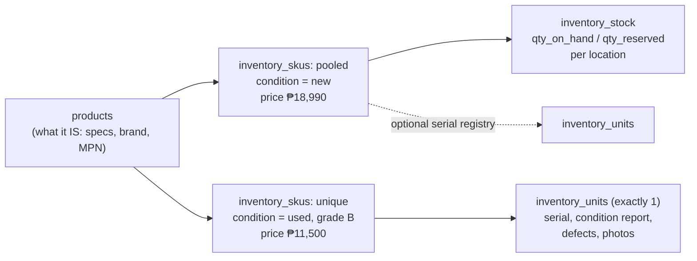
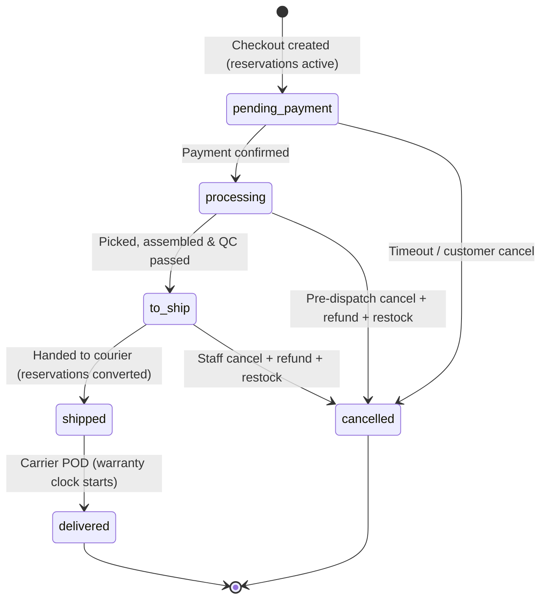
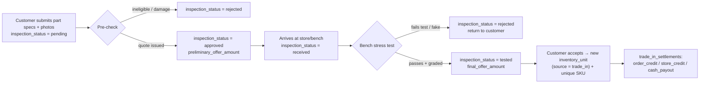

# 🗄️ PC Shop & AI Rig Builder: PostgreSQL Database Schema

> **Author role:** Senior Database Architect
> **Target:** PostgreSQL 15+ (tested on 18) · Prisma ORM · `pgvector`
> **Scope:** New and used/refurbished component sales, AI PC Builder, cart/checkout, order lifecycle, RMA, trade-ins/part swaps, and unified AI + human messaging.

---

## 📑 Table of Contents

0. [Design Principles & Conventions](#0-design-principles--conventions)
1. [Module 1: Users & Access Control](#module-1--users--access-control)
2. [Module 2: Product Catalog, Condition Grading & PC Compatibility](#module-2--product-catalog-condition-grading--pc-compatibility)
3. [Module 3: AI PC Builder & Shopping Cart](#module-3--ai-pc-builder--shopping-cart)
4. [Module 4: Order Lifecycle, Cancellations & Fulfillment](#module-4--order-lifecycle-cancellations--fulfillment)
5. [Module 5: Returns (RMA) & Part Swapping / Trade-Ins](#module-5--returns-rma--part-swapping--trade-ins)
6. [Module 6: Unified Messaging (AI Chatbot & Human Support)](#module-6--unified-messaging-ai-chatbot--human-support)
7. [Shared Triggers (`updated_at`)](#7-shared-triggers)
8. [Deliverable 2: How the AI Builder Queries Compatible, In-Stock Builds](#8-deliverable-2--how-the-ai-builder-queries-compatible-in-stock-builds)
9. [Deliverable 3: Indexes & Constraints That Prevent Overselling](#9-deliverable-3--indexes--constraints-that-prevent-overselling)
10. [Index Catalog](#10-index-catalog)
11. [Prisma Integration Notes](#11-prisma-integration-notes)
12. [Open Decisions](#12-open-decisions)

---

## 0. Design Principles & Conventions

| Concern | Decision | Why |
|---|---|---|
| **Primary keys** | `uuid DEFAULT gen_random_uuid()` for business entities; `bigint IDENTITY` for high-volume append-only logs (messages, ledgers, history); `smallint IDENTITY` for small lookup tables | UUIDs are safe to expose in URLs and can be generated by the client for idempotency. Sequential bigints keep hot append-only indexes compact. *On PG 18 you can switch to `uuidv7()` to get time-ordered UUIDs.* |
| **Money** | `numeric(12,2)` via the `money_amount` domain (non-negative) plus a `currency` column defaulting to `PHP` | No floating-point rounding. Signed amounts (ledgers, adjustments) use plain `numeric(12,2)`. |
| **Time** | Always `timestamptz` | Avoids timezone bugs between PayMongo webhooks, couriers, and the UI. |
| **Status lifecycles** | Native `ENUM`s. State machines are **enforced in the database** with transition tables + triggers | A buggy endpoint can't skip `pending_payment → shipped`. |
| **Compatibility specs** | **Typed, per-category spec tables** (class-table inheritance), *not* EAV or JSONB | B-tree indexable, type-checked, and joinable with exact equality, so the AI's filters are deterministic. |
| **Integrity anchors** | Composite foreign keys such as `(sku_id, tracking_mode)` and `(product_id, component_type)` | Lets the database enforce cross-table rules declaratively, e.g. "a *used* SKU can only have quantity 1 in a cart". |
| **Snapshots** | Orders copy names, prices, grades, addresses, and serials at purchase time | Historical orders stay correct after catalog edits. |
| **Soft delete** | `deleted_at` only where users expect "undo" or where legal retention applies (users, addresses, saved builds) | Hard deletes everywhere else keep queries simple. |
| **Naming** | `snake_case`, plural table names, `<table>_<cols>_uq/_idx/_ck/_fk` | Predictable for Prisma `@map` and for ops. |

### 0.1 Extensions, domains, shared enums & helpers

```sql
-- ============================================================
-- 0. EXTENSIONS, DOMAINS, SHARED TYPES
-- ============================================================
CREATE EXTENSION IF NOT EXISTS pgcrypto;    -- digest(), gen_random_bytes() (gen_random_uuid() is core since PG13)
CREATE EXTENSION IF NOT EXISTS citext;      -- case-insensitive e-mail
CREATE EXTENSION IF NOT EXISTS pg_trgm;     -- fuzzy product-name search
CREATE EXTENSION IF NOT EXISTS btree_gist;  -- exclusion constraints mixing "=" and "&&"

CREATE DOMAIN money_amount  AS numeric(12,2) CHECK (VALUE >= 0);
CREATE DOMAIN currency_code AS char(3)       CHECK (VALUE ~ '^[A-Z]{3}$');

-- Who performed an action (used by order history, cancellations, audit log)
CREATE TYPE actor_type AS ENUM ('customer', 'staff', 'system');

-- Generic updated_at maintenance (attached to every table in §7)
CREATE OR REPLACE FUNCTION trg_set_updated_at() RETURNS trigger
LANGUAGE plpgsql AS $$
BEGIN
  NEW.updated_at := now();
  RETURN NEW;
END $$;
```

### 0.2 High-level entity map



---

## Module 1: Users & Access Control

**Design notes**
- One `users` table for customers, support agents, and admins, with the role in `users.role`. Staff-only data lives in `staff_profiles`. A composite FK `(user_id, role)` means a customer **cannot** have a staff profile, and demoting a staff member to `customer` is blocked until their profile is removed.
- Credentials live in `auth_identities`, so one user can log in with both a password and Google without duplicate accounts.
- Refresh tokens are stored **hashed** and rotated (`replaced_by_session_id`), which lets you detect a stolen token being reused.

```sql
-- ============================================================
-- MODULE 1: USERS & ACCESS CONTROL
-- ============================================================
CREATE TYPE user_role        AS ENUM ('customer', 'support_agent', 'admin');
CREATE TYPE user_status      AS ENUM ('pending_verification', 'active', 'suspended', 'deactivated');
CREATE TYPE auth_provider    AS ENUM ('password', 'google', 'facebook', 'apple');
CREATE TYPE auth_token_kind  AS ENUM ('email_verification', 'password_reset', 'phone_otp');
CREATE TYPE mfa_factor_kind  AS ENUM ('totp', 'webauthn');
CREATE TYPE address_type     AS ENUM ('shipping', 'billing');
CREATE TYPE media_scan_status AS ENUM ('pending', 'clean', 'infected', 'failed');

CREATE TABLE users (
  id                 uuid PRIMARY KEY DEFAULT gen_random_uuid(),
  email              citext       NOT NULL,
  email_verified_at  timestamptz,
  phone              varchar(20),
  phone_verified_at  timestamptz,
  first_name         varchar(100) NOT NULL,
  last_name          varchar(100) NOT NULL,
  display_name       varchar(100),
  avatar_url         text,
  role               user_role    NOT NULL DEFAULT 'customer',
  status             user_status  NOT NULL DEFAULT 'pending_verification',
  marketing_opt_in   boolean      NOT NULL DEFAULT false,
  last_login_at      timestamptz,
  created_at         timestamptz  NOT NULL DEFAULT now(),
  updated_at         timestamptz  NOT NULL DEFAULT now(),
  deleted_at         timestamptz,
  CONSTRAINT users_phone_e164_ck CHECK (phone IS NULL OR phone ~ '^\+[1-9][0-9]{6,14}$'),
  CONSTRAINT users_id_role_uq    UNIQUE (id, role)          -- anchor for staff_profiles composite FK
);
CREATE UNIQUE INDEX users_email_uq ON users (email) WHERE deleted_at IS NULL;
CREATE INDEX users_staff_idx       ON users (role)  WHERE role <> 'customer';

CREATE TABLE auth_identities (
  id                   uuid PRIMARY KEY DEFAULT gen_random_uuid(),
  user_id              uuid          NOT NULL REFERENCES users(id) ON DELETE CASCADE,
  provider             auth_provider NOT NULL,
  provider_subject     varchar(255)  NOT NULL,   -- e-mail for 'password', OIDC "sub" for social logins
  password_hash        text,                     -- argon2id; only for provider = 'password'
  password_changed_at  timestamptz,
  last_used_at         timestamptz,
  created_at           timestamptz   NOT NULL DEFAULT now(),
  CONSTRAINT auth_identities_subject_uq       UNIQUE (provider, provider_subject),
  CONSTRAINT auth_identities_user_provider_uq UNIQUE (user_id, provider),
  CONSTRAINT auth_identities_password_ck      CHECK ((provider = 'password') = (password_hash IS NOT NULL))
);

CREATE TABLE user_mfa_factors (
  id                uuid PRIMARY KEY DEFAULT gen_random_uuid(),
  user_id           uuid            NOT NULL REFERENCES users(id) ON DELETE CASCADE,
  kind              mfa_factor_kind NOT NULL,
  secret_encrypted  bytea           NOT NULL,  -- encrypted with an app-level KMS key, never plaintext
  label             varchar(60),
  verified_at       timestamptz,
  created_at        timestamptz     NOT NULL DEFAULT now()
);

CREATE TABLE user_sessions (
  id                      uuid PRIMARY KEY DEFAULT gen_random_uuid(),
  user_id                 uuid        NOT NULL REFERENCES users(id) ON DELETE CASCADE,
  refresh_token_hash      bytea       NOT NULL UNIQUE,      -- sha256(opaque token)
  replaced_by_session_id  uuid        REFERENCES user_sessions(id),
  ip_address              inet,
  user_agent              text,
  created_at              timestamptz NOT NULL DEFAULT now(),
  expires_at              timestamptz NOT NULL,
  revoked_at              timestamptz
);
CREATE INDEX user_sessions_user_active_idx ON user_sessions (user_id) WHERE revoked_at IS NULL;

CREATE TABLE auth_tokens (
  id           uuid PRIMARY KEY DEFAULT gen_random_uuid(),
  user_id      uuid            NOT NULL REFERENCES users(id) ON DELETE CASCADE,
  kind         auth_token_kind NOT NULL,
  token_hash   bytea           NOT NULL UNIQUE,
  expires_at   timestamptz     NOT NULL,
  consumed_at  timestamptz,
  created_at   timestamptz     NOT NULL DEFAULT now()
);

-- Staff-only attributes. Composite FK guarantees the user's role is staff.
CREATE TABLE staff_profiles (
  user_id               uuid PRIMARY KEY,
  role                  user_role   NOT NULL CHECK (role IN ('support_agent', 'admin')),
  employee_code         varchar(20) NOT NULL UNIQUE,
  job_title             varchar(100),
  is_available_for_chat boolean     NOT NULL DEFAULT false,
  max_concurrent_chats  smallint    NOT NULL DEFAULT 5 CHECK (max_concurrent_chats BETWEEN 0 AND 50),
  can_inspect_hardware  boolean     NOT NULL DEFAULT false,   -- trade-in / RMA bench technician
  created_at            timestamptz NOT NULL DEFAULT now(),
  updated_at            timestamptz NOT NULL DEFAULT now(),
  CONSTRAINT staff_profiles_user_role_fk
    FOREIGN KEY (user_id, role) REFERENCES users (id, role) ON UPDATE CASCADE ON DELETE CASCADE
);

-- Lightweight RBAC: permissions are granted per role.
CREATE TABLE permissions (
  code         varchar(60) PRIMARY KEY,           -- e.g. 'refunds.approve'
  description  text        NOT NULL
);
CREATE TABLE role_permissions (
  role             user_role   NOT NULL,
  permission_code  varchar(60) NOT NULL REFERENCES permissions(code) ON DELETE CASCADE,
  PRIMARY KEY (role, permission_code)
);

CREATE TABLE addresses (
  id                   uuid PRIMARY KEY DEFAULT gen_random_uuid(),
  user_id              uuid         NOT NULL REFERENCES users(id) ON DELETE CASCADE,
  label                varchar(50),                -- 'Home', 'Office'
  recipient_name       varchar(150) NOT NULL,
  phone                varchar(20)  NOT NULL,
  line1                varchar(255) NOT NULL,
  line2                varchar(255),
  barangay             varchar(100),               -- PH-specific; NULL elsewhere
  city                 varchar(100) NOT NULL,
  province             varchar(100) NOT NULL,
  postal_code          varchar(20)  NOT NULL,
  country_code         char(2)      NOT NULL DEFAULT 'PH',
  is_default_shipping  boolean      NOT NULL DEFAULT false,
  is_default_billing   boolean      NOT NULL DEFAULT false,
  created_at           timestamptz  NOT NULL DEFAULT now(),
  updated_at           timestamptz  NOT NULL DEFAULT now(),
  deleted_at           timestamptz
);
CREATE INDEX addresses_user_idx ON addresses (user_id) WHERE deleted_at IS NULL;
CREATE UNIQUE INDEX addresses_default_shipping_uq ON addresses (user_id) WHERE is_default_shipping AND deleted_at IS NULL;
CREATE UNIQUE INDEX addresses_default_billing_uq  ON addresses (user_id) WHERE is_default_billing  AND deleted_at IS NULL;

-- Shared: file metadata (product photos, used-unit photos, trade-in photos, RMA evidence, chat attachments).
-- Binary content lives in object storage (S3/R2); Postgres stores only metadata.
CREATE TABLE media_assets (
  id                 uuid PRIMARY KEY DEFAULT gen_random_uuid(),
  storage_key        text              NOT NULL UNIQUE,
  original_filename  varchar(255),
  mime_type          varchar(100)      NOT NULL,
  size_bytes         bigint            NOT NULL CHECK (size_bytes > 0 AND size_bytes <= 26214400),  -- 25 MB cap
  width_px           integer,
  height_px          integer,
  checksum_sha256    bytea             NOT NULL,
  scan_status        media_scan_status NOT NULL DEFAULT 'pending',   -- antivirus gate before display
  is_public          boolean           NOT NULL DEFAULT false,
  uploaded_by        uuid              REFERENCES users(id) ON DELETE SET NULL,
  created_at         timestamptz       NOT NULL DEFAULT now()
);

-- Shared: append-only audit trail for privileged actions (price edits, refunds, manual stock adjustments).
CREATE TABLE audit_log (
  id             bigint GENERATED ALWAYS AS IDENTITY PRIMARY KEY,
  actor_user_id  uuid        REFERENCES users(id) ON DELETE SET NULL,
  actor          actor_type  NOT NULL,
  action         varchar(60) NOT NULL,       -- 'sku.price_changed', 'refund.approved'
  entity_type    varchar(40) NOT NULL,
  entity_id      text        NOT NULL,
  before_data    jsonb,
  after_data     jsonb,
  ip_address     inet,
  request_id     uuid,
  created_at     timestamptz NOT NULL DEFAULT now()
);
CREATE INDEX audit_log_entity_idx ON audit_log (entity_type, entity_id, created_at DESC);
```

---

## Module 2: Product Catalog, Condition Grading & PC Compatibility

### 2.1 The three-layer inventory model



| Layer | Table | Brand-new (bulk) | Used / Refurbished / Open-box |
|---|---|---|---|
| **What it is** | `products` + `*_specs` | Shared | Shared (a used RTX 4070 has the same specs as a new one) |
| **What we sell** | `inventory_skus` | **One `pooled` SKU** per product + condition | **One `unique` SKU per physical item**, with its own grade, notes, and price |
| **How many** | `inventory_stock` / `inventory_units` | Counters (`qty_on_hand`, `qty_reserved`) per location | Exactly one `inventory_units` row whose `status` *is* the availability |

Because specs hang off `products`, the AI Builder runs compatibility logic **once per product** and then picks between new and used SKUs purely on price and condition.

### 2.2 Catalog & specification DDL

```sql
-- ============================================================
-- MODULE 2: CATALOG, CONDITION GRADING, COMPATIBILITY
-- ============================================================
CREATE TYPE component_type      AS ENUM ('cpu', 'gpu', 'motherboard', 'ram', 'storage', 'psu', 'case', 'cooler', 'accessory');
CREATE TYPE item_condition      AS ENUM ('new', 'open_box', 'refurbished', 'used');
CREATE TYPE condition_grade     AS ENUM ('A', 'B', 'C', 'D');   -- A: like new · B: light wear · C: visible wear · D: functional, heavy wear
CREATE TYPE tracking_mode       AS ENUM ('pooled', 'unique');
CREATE TYPE listing_status      AS ENUM ('draft', 'active', 'paused', 'archived');
CREATE TYPE color_family        AS ENUM ('black', 'white', 'silver', 'gray', 'pink', 'blue', 'red', 'multi', 'other');
CREATE TYPE memory_type         AS ENUM ('ddr3', 'ddr4', 'ddr5');
CREATE TYPE mb_form_factor      AS ENUM ('e_atx', 'atx', 'micro_atx', 'mini_itx');
CREATE TYPE psu_form_factor     AS ENUM ('atx', 'sfx', 'sfx_l', 'tfx');
CREATE TYPE psu_efficiency      AS ENUM ('none', 'white', 'bronze', 'silver', 'gold', 'platinum', 'titanium');
CREATE TYPE psu_modularity      AS ENUM ('non_modular', 'semi_modular', 'fully_modular');
CREATE TYPE storage_kind        AS ENUM ('nvme_ssd', 'sata_ssd', 'hdd');
CREATE TYPE storage_form_factor AS ENUM ('m2_2230', 'm2_2242', 'm2_2280', '2_5_inch', '3_5_inch');
CREATE TYPE storage_interface   AS ENUM ('pcie3_x4', 'pcie4_x4', 'pcie5_x4', 'sata3');
CREATE TYPE cooler_kind         AS ENUM ('air', 'aio_liquid');
CREATE TYPE radiator_position   AS ENUM ('front', 'top', 'side', 'rear', 'bottom');
CREATE TYPE compat_verdict      AS ENUM ('incompatible', 'requires_bios_update', 'requires_adapter', 'verified_compatible');

-- ---------- Taxonomy ----------
CREATE TABLE categories (
  id              smallint GENERATED ALWAYS AS IDENTITY PRIMARY KEY,
  parent_id       smallint       REFERENCES categories(id),
  component_type  component_type NOT NULL,      -- sub-categories ("NVMe SSD") inherit their parent's type
  name            varchar(100)   NOT NULL,
  slug            varchar(120)   NOT NULL UNIQUE,
  sort_order      smallint       NOT NULL DEFAULT 0,
  is_active       boolean        NOT NULL DEFAULT true,
  CONSTRAINT categories_id_type_uq UNIQUE (id, component_type)
);

CREATE TABLE brands (
  id    smallint GENERATED ALWAYS AS IDENTITY PRIMARY KEY,
  name  varchar(80)  NOT NULL UNIQUE,
  slug  varchar(100) NOT NULL UNIQUE
);

-- ---------- Base product (one row per manufacturer model) ----------
CREATE TABLE products (
  id                            uuid PRIMARY KEY DEFAULT gen_random_uuid(),
  category_id                   smallint       NOT NULL,
  component_type                component_type NOT NULL,
  brand_id                      smallint       NOT NULL REFERENCES brands(id),
  mpn                           varchar(100),                  -- manufacturer part number
  upc_ean                       varchar(14),
  name                          varchar(255)   NOT NULL,
  slug                          varchar(280)   NOT NULL UNIQUE,
  model_series                  varchar(100),
  description                   text,
  color                         color_family   NOT NULL DEFAULT 'black',   -- aesthetic filter for the AI Builder
  has_rgb                       boolean        NOT NULL DEFAULT false,
  release_date                  date,
  msrp                          money_amount,
  manufacturer_warranty_months  smallint,
  weight_grams                  integer,
  is_active                     boolean        NOT NULL DEFAULT true,
  search_vector                 tsvector GENERATED ALWAYS AS (
                                  to_tsvector('simple'::regconfig,
                                    coalesce(name, '') || ' ' || coalesce(mpn, '') || ' ' || coalesce(model_series, ''))
                                ) STORED,
  created_at                    timestamptz    NOT NULL DEFAULT now(),
  updated_at                    timestamptz    NOT NULL DEFAULT now(),
  CONSTRAINT products_category_type_fk FOREIGN KEY (category_id, component_type)
                                       REFERENCES categories (id, component_type),
  CONSTRAINT products_id_type_uq   UNIQUE (id, component_type),     -- anchor for spec tables
  CONSTRAINT products_brand_mpn_uq UNIQUE (brand_id, mpn)
);
CREATE INDEX products_type_active_idx ON products (component_type) WHERE is_active;
CREATE INDEX products_search_idx      ON products USING gin (search_vector);
CREATE INDEX products_name_trgm_idx   ON products USING gin (name gin_trgm_ops);

CREATE TABLE product_images (
  product_id  uuid     NOT NULL REFERENCES products(id) ON DELETE CASCADE,
  media_id    uuid     NOT NULL REFERENCES media_assets(id),
  sort_order  smallint NOT NULL DEFAULT 0,
  is_primary  boolean  NOT NULL DEFAULT false,
  PRIMARY KEY (product_id, media_id)
);
CREATE UNIQUE INDEX product_images_one_primary_uq ON product_images (product_id) WHERE is_primary;

-- ---------- Compatibility lookup: sockets are data, not an enum (new sockets ship yearly) ----------
CREATE TABLE cpu_sockets (
  id          smallint GENERATED ALWAYS AS IDENTITY PRIMARY KEY,
  code        varchar(30) NOT NULL UNIQUE,                 -- 'AM5', 'AM4', 'LGA1700', 'LGA1851'
  vendor      varchar(10) NOT NULL CHECK (vendor IN ('amd', 'intel')),
  is_current  boolean     NOT NULL DEFAULT true
);

-- ---------- Typed spec tables (class-table inheritance) ----------
-- Each spec row's (product_id, component_type) must match products, so a GPU can never get CPU specs.

CREATE TABLE cpu_specs (
  product_id               uuid PRIMARY KEY,
  component_type           component_type NOT NULL DEFAULT 'cpu' CHECK (component_type = 'cpu'),
  socket_id                smallint NOT NULL REFERENCES cpu_sockets(id),
  core_count               smallint NOT NULL CHECK (core_count > 0),
  thread_count             smallint NOT NULL,
  base_clock_mhz           integer  NOT NULL,
  boost_clock_mhz          integer,
  l3_cache_mb              smallint,
  tdp_w                    smallint NOT NULL CHECK (tdp_w > 0),
  max_power_w              smallint,                       -- PPT / PL2: used for PSU sizing when present
  has_integrated_graphics  boolean  NOT NULL,
  includes_stock_cooler    boolean  NOT NULL DEFAULT false,
  max_memory_speed_mts     integer,
  pcie_version             smallint,
  unlocked                 boolean  NOT NULL DEFAULT false,
  perf_score               integer,                        -- normalized benchmark index for value optimization
  CONSTRAINT cpu_specs_product_fk FOREIGN KEY (product_id, component_type)
                                  REFERENCES products (id, component_type) ON DELETE CASCADE,
  CONSTRAINT cpu_specs_threads_ck CHECK (thread_count >= core_count)
);
CREATE INDEX cpu_specs_socket_idx ON cpu_specs (socket_id);

CREATE TABLE cpu_supported_memory_types (
  cpu_product_id  uuid        NOT NULL REFERENCES cpu_specs(product_id) ON DELETE CASCADE,
  memory_type     memory_type NOT NULL,
  PRIMARY KEY (cpu_product_id, memory_type)
);

CREATE TABLE gpu_specs (
  product_id         uuid PRIMARY KEY,
  component_type     component_type NOT NULL DEFAULT 'gpu' CHECK (component_type = 'gpu'),
  chipset            varchar(60)  NOT NULL,                -- 'GeForce RTX 4070 SUPER'
  chipset_vendor     varchar(10)  NOT NULL CHECK (chipset_vendor IN ('nvidia', 'amd', 'intel')),
  vram_gb            smallint     NOT NULL CHECK (vram_gb > 0),
  vram_type          varchar(10),
  length_mm          smallint     NOT NULL CHECK (length_mm > 0),
  slot_width         numeric(2,1) NOT NULL,                -- 2.0, 2.5, 3.0
  board_power_w      smallint     NOT NULL CHECK (board_power_w > 0),
  recommended_psu_w  smallint,
  pcie_8pin_count    smallint     NOT NULL DEFAULT 0,
  has_12vhpwr        boolean      NOT NULL DEFAULT false,  -- 12VHPWR / 12V-2x6
  pcie_version       smallint,
  perf_score         integer,
  CONSTRAINT gpu_specs_product_fk FOREIGN KEY (product_id, component_type)
                                  REFERENCES products (id, component_type) ON DELETE CASCADE
);
CREATE INDEX gpu_specs_length_idx ON gpu_specs (length_mm);
CREATE INDEX gpu_specs_perf_idx   ON gpu_specs (perf_score DESC);

CREATE TABLE motherboard_specs (
  product_id            uuid PRIMARY KEY,
  component_type        component_type NOT NULL DEFAULT 'motherboard' CHECK (component_type = 'motherboard'),
  socket_id             smallint       NOT NULL REFERENCES cpu_sockets(id),
  chipset               varchar(30)    NOT NULL,           -- 'B650', 'Z790'
  form_factor           mb_form_factor NOT NULL,
  memory_type           memory_type    NOT NULL,
  memory_slots          smallint       NOT NULL CHECK (memory_slots IN (1, 2, 4, 8)),
  max_memory_gb         smallint       NOT NULL,
  max_memory_speed_mts  integer,
  m2_slots              smallint       NOT NULL DEFAULT 0,
  sata_ports            smallint       NOT NULL DEFAULT 0,
  pcie_x16_slots        smallint       NOT NULL DEFAULT 1,
  pcie_version          smallint,
  has_wifi              boolean        NOT NULL DEFAULT false,
  has_bios_flashback    boolean        NOT NULL DEFAULT false,
  CONSTRAINT motherboard_specs_product_fk FOREIGN KEY (product_id, component_type)
                                          REFERENCES products (id, component_type) ON DELETE CASCADE
);
-- The single most important compatibility index: socket + memory type + form factor
CREATE INDEX motherboard_specs_compat_idx ON motherboard_specs (socket_id, memory_type, form_factor);

CREATE TABLE ram_specs (
  product_id              uuid PRIMARY KEY,
  component_type          component_type NOT NULL DEFAULT 'ram' CHECK (component_type = 'ram'),
  memory_type             memory_type  NOT NULL,
  module_form             varchar(8)   NOT NULL DEFAULT 'dimm' CHECK (module_form IN ('dimm', 'sodimm')),
  module_count            smallint     NOT NULL CHECK (module_count IN (1, 2, 4, 8)),
  capacity_per_module_gb  smallint     NOT NULL CHECK (capacity_per_module_gb > 0),
  total_capacity_gb       smallint     GENERATED ALWAYS AS (module_count * capacity_per_module_gb) STORED,
  speed_mts               integer      NOT NULL,
  cas_latency             smallint,
  voltage                 numeric(3,2),
  height_mm               smallint,                        -- tall heat-spreaders vs. air-cooler clearance
  CONSTRAINT ram_specs_product_fk FOREIGN KEY (product_id, component_type)
                                  REFERENCES products (id, component_type) ON DELETE CASCADE
);
CREATE INDEX ram_specs_type_speed_idx ON ram_specs (memory_type, speed_mts);

CREATE TABLE storage_specs (
  product_id      uuid PRIMARY KEY,
  component_type  component_type      NOT NULL DEFAULT 'storage' CHECK (component_type = 'storage'),
  kind            storage_kind        NOT NULL,
  form_factor     storage_form_factor NOT NULL,
  interface       storage_interface   NOT NULL,
  capacity_gb     integer             NOT NULL CHECK (capacity_gb > 0),
  seq_read_mbps   integer,
  seq_write_mbps  integer,
  endurance_tbw   integer,
  CONSTRAINT storage_specs_product_fk FOREIGN KEY (product_id, component_type)
                                      REFERENCES products (id, component_type) ON DELETE CASCADE,
  CONSTRAINT storage_specs_nvme_ck CHECK (kind <> 'nvme_ssd' OR (interface <> 'sata3' AND form_factor IN ('m2_2230', 'm2_2242', 'm2_2280'))),
  CONSTRAINT storage_specs_hdd_ck  CHECK (kind <> 'hdd' OR form_factor IN ('2_5_inch', '3_5_inch'))
);

CREATE TABLE psu_specs (
  product_id       uuid PRIMARY KEY,
  component_type   component_type  NOT NULL DEFAULT 'psu' CHECK (component_type = 'psu'),
  wattage          smallint        NOT NULL CHECK (wattage BETWEEN 200 AND 3000),
  form_factor      psu_form_factor NOT NULL,
  efficiency       psu_efficiency  NOT NULL,
  modularity       psu_modularity  NOT NULL,
  pcie_8pin_count  smallint        NOT NULL DEFAULT 0,
  has_12vhpwr      boolean         NOT NULL DEFAULT false,
  atx_version      varchar(5),                             -- '3.0', '3.1'
  length_mm        smallint,
  CONSTRAINT psu_specs_product_fk FOREIGN KEY (product_id, component_type)
                                  REFERENCES products (id, component_type) ON DELETE CASCADE
);
CREATE INDEX psu_specs_watt_idx ON psu_specs (form_factor, wattage);

CREATE TABLE case_specs (
  product_id                uuid PRIMARY KEY,
  component_type            component_type NOT NULL DEFAULT 'case' CHECK (component_type = 'case'),
  size_class                varchar(12) NOT NULL CHECK (size_class IN ('full_tower', 'mid_tower', 'mini_tower', 'sff')),
  max_gpu_length_mm         smallint NOT NULL,
  max_cpu_cooler_height_mm  smallint NOT NULL,
  max_psu_length_mm         smallint,
  expansion_slots           smallint NOT NULL,
  bays_2_5                  smallint NOT NULL DEFAULT 0,
  bays_3_5                  smallint NOT NULL DEFAULT 0,
  included_fans             smallint NOT NULL DEFAULT 0,
  side_panel                varchar(16) CHECK (side_panel IN ('tempered_glass', 'mesh', 'solid', 'acrylic')),
  CONSTRAINT case_specs_product_fk FOREIGN KEY (product_id, component_type)
                                   REFERENCES products (id, component_type) ON DELETE CASCADE
);
CREATE INDEX case_specs_clearance_idx ON case_specs (max_gpu_length_mm, max_cpu_cooler_height_mm);

-- Multi-valued compatibility facts are junction tables (normalized and indexable), not arrays or JSON.
CREATE TABLE case_supported_mb_form_factors (
  case_product_id  uuid           NOT NULL REFERENCES case_specs(product_id) ON DELETE CASCADE,
  form_factor      mb_form_factor NOT NULL,
  PRIMARY KEY (case_product_id, form_factor)
);
CREATE INDEX case_mb_ff_reverse_idx ON case_supported_mb_form_factors (form_factor, case_product_id);

CREATE TABLE case_supported_psu_form_factors (
  case_product_id  uuid            NOT NULL REFERENCES case_specs(product_id) ON DELETE CASCADE,
  form_factor      psu_form_factor NOT NULL,
  PRIMARY KEY (case_product_id, form_factor)
);

CREATE TABLE case_radiator_mounts (
  case_product_id  uuid              NOT NULL REFERENCES case_specs(product_id) ON DELETE CASCADE,
  position         radiator_position NOT NULL,
  max_radiator_mm  smallint          NOT NULL CHECK (max_radiator_mm IN (120, 140, 240, 280, 360, 420)),
  PRIMARY KEY (case_product_id, position)
);

CREATE TABLE cooler_specs (
  product_id        uuid PRIMARY KEY,
  component_type    component_type NOT NULL DEFAULT 'cooler' CHECK (component_type = 'cooler'),
  kind              cooler_kind    NOT NULL,
  height_mm         smallint,                              -- air coolers
  radiator_size_mm  smallint CHECK (radiator_size_mm IN (120, 140, 240, 280, 360, 420)),  -- AIOs
  tdp_rating_w      smallint,
  ram_clearance_mm  smallint,
  noise_db          numeric(4,1),
  CONSTRAINT cooler_specs_product_fk FOREIGN KEY (product_id, component_type)
                                     REFERENCES products (id, component_type) ON DELETE CASCADE,
  CONSTRAINT cooler_specs_kind_ck CHECK (
       (kind = 'air'        AND height_mm IS NOT NULL AND radiator_size_mm IS NULL)
    OR (kind = 'aio_liquid' AND radiator_size_mm IS NOT NULL))
);

CREATE TABLE cooler_supported_sockets (
  cooler_product_id  uuid     NOT NULL REFERENCES cooler_specs(product_id) ON DELETE CASCADE,
  socket_id          smallint NOT NULL REFERENCES cpu_sockets(id),
  PRIMARY KEY (cooler_product_id, socket_id)
);
CREATE INDEX cooler_sockets_reverse_idx ON cooler_supported_sockets (socket_id, cooler_product_id);

-- Known exceptions the rule engine can't infer (BIOS-update requirements, physical quirks).
CREATE TABLE compatibility_overrides (
  id            uuid PRIMARY KEY DEFAULT gen_random_uuid(),
  product_a_id  uuid           NOT NULL REFERENCES products(id) ON DELETE CASCADE,
  product_b_id  uuid           NOT NULL REFERENCES products(id) ON DELETE CASCADE,
  verdict       compat_verdict NOT NULL,
  note          text           NOT NULL,
  created_by    uuid           REFERENCES users(id),
  created_at    timestamptz    NOT NULL DEFAULT now(),
  CONSTRAINT compat_overrides_order_ck CHECK (product_a_id < product_b_id),   -- one canonical row per pair
  CONSTRAINT compat_overrides_pair_uq  UNIQUE (product_a_id, product_b_id)
);
CREATE INDEX compat_overrides_b_idx ON compatibility_overrides (product_b_id);
```

### 2.3 Sellable inventory: SKUs, stock counters, physical units & grading

```sql
-- ---------- Inventory ----------
CREATE TYPE unit_status AS ENUM (
  'pending_inspection',  -- received, not yet tested/graded
  'available',           -- sellable
  'reserved',            -- held by a checkout / unpaid order
  'allocated',           -- picked and bound to a paid order
  'shipped',             -- left the building
  'sold',                -- delivered; return window may still be open
  'in_rma',              -- back from customer, under inspection
  'quarantined',         -- failed test / suspected counterfeit or stolen
  'written_off'
);
CREATE TYPE unit_source             AS ENUM ('supplier_purchase', 'trade_in', 'customer_return', 'consignment');
CREATE TYPE defect_type             AS ENUM ('cosmetic_scratch', 'cosmetic_dent', 'discoloration', 'missing_accessory', 'missing_box',
                                             'bent_pins', 'damaged_connector', 'fan_noise', 'coil_whine', 'thermal_issue',
                                             'display_artifact', 'bios_issue', 'other');
CREATE TYPE defect_severity         AS ENUM ('cosmetic', 'minor_functional', 'major_functional');
CREATE TYPE inventory_movement_type AS ENUM ('receive', 'reserve', 'release', 'ship', 'return_restock', 'trade_in_intake',
                                             'regrade', 'transfer', 'adjustment', 'write_off');

CREATE TABLE stock_locations (
  id               smallint GENERATED ALWAYS AS IDENTITY PRIMARY KEY,
  code             varchar(20)  NOT NULL UNIQUE,     -- 'MNL-WH1', 'QC-STORE'
  name             varchar(100) NOT NULL,
  address          text,
  is_pickup_point  boolean      NOT NULL DEFAULT false,
  is_active        boolean      NOT NULL DEFAULT true
);

-- The sellable listing. This is what carts, orders, and AI recommendations point to.
CREATE TABLE inventory_skus (
  id                  uuid PRIMARY KEY DEFAULT gen_random_uuid(),
  product_id          uuid           NOT NULL,
  component_type      component_type NOT NULL,           -- denormalized via composite FK, used for slot validation
  sku_code            varchar(40)    NOT NULL UNIQUE,    -- 'GPU-4070S-ASUS-NEW', 'GPU-4070S-U-000123'
  condition           item_condition NOT NULL,
  tracking_mode       tracking_mode  NOT NULL,
  grade               condition_grade,                   -- NULL only for brand-new
  price               money_amount   NOT NULL CHECK (price > 0),
  compare_at_price    money_amount,                      -- "was" price / new-price reference on used listings
  unit_cost           money_amount,                      -- internal only; never exposed to AI or customers
  currency            currency_code  NOT NULL DEFAULT 'PHP',
  warranty_months     smallint       NOT NULL DEFAULT 0 CHECK (warranty_months >= 0),
  return_window_days  smallint       NOT NULL DEFAULT 7  CHECK (return_window_days >= 0),
  listing_status      listing_status NOT NULL DEFAULT 'draft',
  listing_title       varchar(160),                      -- "Grade B: light scratches on backplate"
  condition_summary   text,                              -- customer-facing disclosure
  published_at        timestamptz,
  created_at          timestamptz    NOT NULL DEFAULT now(),
  updated_at          timestamptz    NOT NULL DEFAULT now(),
  CONSTRAINT inventory_skus_product_fk  FOREIGN KEY (product_id, component_type) REFERENCES products (id, component_type),
  -- Integrity anchors referenced by composite FKs elsewhere:
  CONSTRAINT inventory_skus_id_mode_uq         UNIQUE (id, tracking_mode),
  CONSTRAINT inventory_skus_id_type_uq         UNIQUE (id, component_type),
  CONSTRAINT inventory_skus_id_product_uq      UNIQUE (id, product_id),
  CONSTRAINT inventory_skus_id_product_mode_uq UNIQUE (id, product_id, tracking_mode),
  -- Business rules:
  CONSTRAINT inventory_skus_grade_ck       CHECK ((condition = 'new') = (grade IS NULL)),
  CONSTRAINT inventory_skus_preowned_ck    CHECK (condition = 'new' OR tracking_mode = 'unique'),  -- every pre-owned item is individually listed
  CONSTRAINT inventory_skus_compare_ck     CHECK (compare_at_price IS NULL OR compare_at_price > price)
);
-- Only one live pooled listing per product + condition (prevents split stock across duplicate SKUs)
CREATE UNIQUE INDEX inventory_skus_one_pooled_uq ON inventory_skus (product_id, condition)
  WHERE tracking_mode = 'pooled' AND listing_status <> 'archived';
CREATE INDEX inventory_skus_active_idx ON inventory_skus (component_type, price)
  INCLUDE (product_id, condition, grade) WHERE listing_status = 'active';
CREATE INDEX inventory_skus_product_idx ON inventory_skus (product_id) WHERE listing_status = 'active';

-- Pooled stock counters (brand-new bulk items), one row per SKU per location.
CREATE TABLE inventory_stock (
  sku_id         uuid          NOT NULL,
  tracking_mode  tracking_mode NOT NULL DEFAULT 'pooled' CHECK (tracking_mode = 'pooled'),
  location_id    smallint      NOT NULL REFERENCES stock_locations(id),
  qty_on_hand    integer       NOT NULL DEFAULT 0,
  qty_reserved   integer       NOT NULL DEFAULT 0,
  qty_available  integer       GENERATED ALWAYS AS (qty_on_hand - qty_reserved) STORED,
  reorder_point  integer,
  updated_at     timestamptz   NOT NULL DEFAULT now(),
  PRIMARY KEY (sku_id, location_id),
  CONSTRAINT inventory_stock_sku_fk FOREIGN KEY (sku_id, tracking_mode) REFERENCES inventory_skus (id, tracking_mode),
  CONSTRAINT inventory_stock_on_hand_ck  CHECK (qty_on_hand  >= 0),
  CONSTRAINT inventory_stock_reserved_ck CHECK (qty_reserved >= 0),
  CONSTRAINT inventory_stock_no_oversell_ck CHECK (qty_reserved <= qty_on_hand)       -- ★ oversell guard
);
CREATE INDEX inventory_stock_in_stock_idx ON inventory_stock (sku_id) WHERE qty_on_hand > qty_reserved;

-- Physical units. Mandatory (exactly 1) for 'unique' SKUs; optional serial registry for 'pooled' SKUs.
-- A unit is a physical object: it keeps ONE row for life, even if it's sold, returned, and relisted under a new SKU.
CREATE TABLE inventory_units (
  id                        uuid PRIMARY KEY DEFAULT gen_random_uuid(),
  sku_id                    uuid          NOT NULL,
  product_id                uuid          NOT NULL,
  tracking_mode             tracking_mode NOT NULL,
  location_id               smallint      REFERENCES stock_locations(id),
  bin_location              varchar(30),
  serial_number             varchar(100),
  status                    unit_status   NOT NULL DEFAULT 'pending_inspection',
  source                    unit_source   NOT NULL,
  source_trade_in_item_id   uuid,          -- FK added in Module 5
  source_return_item_id     uuid,          -- FK added in Module 5
  acquisition_cost          money_amount,
  manufacture_date          date,
  original_purchase_date    date,
  mfr_warranty_until        date,          -- remaining manufacturer warranty (sales argument for used parts)
  received_at               timestamptz   NOT NULL DEFAULT now(),
  version                   integer       NOT NULL DEFAULT 0,
  created_at                timestamptz   NOT NULL DEFAULT now(),
  updated_at                timestamptz   NOT NULL DEFAULT now(),
  CONSTRAINT inventory_units_sku_fk FOREIGN KEY (sku_id, product_id, tracking_mode)
                                    REFERENCES inventory_skus (id, product_id, tracking_mode)
);
CREATE UNIQUE INDEX inventory_units_one_per_unique_sku_uq ON inventory_units (sku_id) WHERE tracking_mode = 'unique';  -- ★
CREATE UNIQUE INDEX inventory_units_serial_uq ON inventory_units (product_id, serial_number) WHERE serial_number IS NOT NULL;
CREATE INDEX inventory_units_available_idx    ON inventory_units (sku_id) WHERE status = 'available';
CREATE INDEX inventory_units_status_idx       ON inventory_units (status, location_id);

-- Condition grading history (latest report is is_current = true)
CREATE TABLE unit_condition_reports (
  id                    uuid PRIMARY KEY DEFAULT gen_random_uuid(),
  unit_id               uuid            NOT NULL REFERENCES inventory_units(id) ON DELETE CASCADE,
  inspected_by          uuid            NOT NULL REFERENCES users(id),
  inspected_at          timestamptz     NOT NULL DEFAULT now(),
  assigned_grade        condition_grade NOT NULL,
  functional_pass       boolean         NOT NULL,
  testing_notes         text,
  cosmetic_notes        text,
  -- Test telemetry is free-form (never used for compatibility filtering), so JSONB is appropriate here:
  -- {"furmark_30min":"pass","max_temp_c":74,"memtest86_passes":4,"crystaldisk_health_pct":97}
  test_results          jsonb           NOT NULL DEFAULT '{}'::jsonb,
  power_on_hours        integer,
  is_current            boolean         NOT NULL DEFAULT true
);
CREATE UNIQUE INDEX unit_condition_reports_current_uq ON unit_condition_reports (unit_id) WHERE is_current;

CREATE TABLE unit_defects (
  id                        uuid PRIMARY KEY DEFAULT gen_random_uuid(),
  unit_id                   uuid            NOT NULL REFERENCES inventory_units(id) ON DELETE CASCADE,
  condition_report_id       uuid            REFERENCES unit_condition_reports(id) ON DELETE SET NULL,
  defect                    defect_type     NOT NULL,
  severity                  defect_severity NOT NULL,
  description               text            NOT NULL,
  disclosed_to_customer     boolean         NOT NULL DEFAULT true,
  media_id                  uuid            REFERENCES media_assets(id),
  created_at                timestamptz     NOT NULL DEFAULT now()
);
CREATE INDEX unit_defects_unit_idx ON unit_defects (unit_id);

CREATE TABLE unit_media (
  unit_id     uuid     NOT NULL REFERENCES inventory_units(id) ON DELETE CASCADE,
  media_id    uuid     NOT NULL REFERENCES media_assets(id),
  caption     varchar(200),
  sort_order  smallint NOT NULL DEFAULT 0,
  PRIMARY KEY (unit_id, media_id)
);

-- Append-only inventory ledger: every quantity change is explainable.
CREATE TABLE inventory_movements (
  id                  bigint GENERATED ALWAYS AS IDENTITY PRIMARY KEY,
  sku_id              uuid                    NOT NULL REFERENCES inventory_skus(id),
  unit_id             uuid                    REFERENCES inventory_units(id),
  location_id         smallint                REFERENCES stock_locations(id),
  movement_type       inventory_movement_type NOT NULL,
  qty_on_hand_delta   integer                 NOT NULL DEFAULT 0,
  qty_reserved_delta  integer                 NOT NULL DEFAULT 0,
  reference_type      varchar(30),            -- 'stock_reservation', 'order', 'return_request', 'trade_in', 'manual'
  reference_id        uuid,
  actor_user_id       uuid                    REFERENCES users(id),
  note                text,
  created_at          timestamptz             NOT NULL DEFAULT now()
);
CREATE INDEX inventory_movements_sku_idx ON inventory_movements (sku_id, created_at DESC);
CREATE INDEX inventory_movements_ref_idx ON inventory_movements (reference_type, reference_id);

-- ★ The ONLY relation the AI layer is allowed to read for "what can I recommend".
CREATE VIEW v_sellable_skus AS
SELECT s.id              AS sku_id,
       s.product_id,
       s.component_type,
       s.condition,
       s.grade,
       s.price,
       s.currency,
       s.warranty_months,
       s.tracking_mode,
       CASE WHEN s.tracking_mode = 'pooled'
            THEN (SELECT COALESCE(SUM(st.qty_available), 0)::int FROM inventory_stock st WHERE st.sku_id = s.id)
            ELSE 1
       END               AS qty_available
FROM inventory_skus s
JOIN products p ON p.id = s.product_id AND p.is_active
WHERE s.listing_status = 'active'
  AND (   (s.tracking_mode = 'pooled'
           AND EXISTS (SELECT 1 FROM inventory_stock st WHERE st.sku_id = s.id AND st.qty_on_hand > st.qty_reserved))
       OR (s.tracking_mode = 'unique'
           AND EXISTS (SELECT 1 FROM inventory_units u WHERE u.sku_id = s.id AND u.status = 'available')));
```

```sql
-- Requires pgvector: semantic search for the AI Inquiry Chatbot (hybrid with the SQL filters above)
CREATE EXTENSION IF NOT EXISTS vector;

CREATE TABLE product_embeddings (
  product_id    uuid PRIMARY KEY REFERENCES products(id) ON DELETE CASCADE,
  model         varchar(60)  NOT NULL,           -- 'text-embedding-004'
  content_hash  bytea        NOT NULL,           -- re-embed only when source text changes
  embedding     vector(768)  NOT NULL,
  updated_at    timestamptz  NOT NULL DEFAULT now()
);
CREATE INDEX product_embeddings_hnsw_idx ON product_embeddings USING hnsw (embedding vector_cosine_ops);
```

> [!NOTE]
> Embeddings live in their own table, not on `products`. That way you can switch embedding models (and dimensions) without touching the catalog, and hot catalog rows stay narrow.

---

## Module 3: AI PC Builder & Shopping Cart

**Design notes**
- **Questionnaire answers are typed columns**, so you can run analytics like "average budget for 1440p gaming". The full Zod payload is also kept in `raw_answers` for prompt replay and auditing.
- One session can produce **several recommendation variants** ("Best Value", "Max FPS", "White Aesthetic"). Each recommendation item has a **hard FK to `inventory_skus`**, and an insert trigger rejects any SKU that isn't sellable *right now*. It also **overwrites the price with the database price**, so the LLM can't make one up.
- **Saved builds reference `products`, not just SKUs.** A used SKU can sell out from under a saved build. The build keeps the *product* plus a `preferred_sku_id`. When the customer clicks "Move to cart", the backend picks the best currently-sellable SKU for that product.
- **Cart builds** group cart lines that arrived together from one build. This supports "remove entire build" and an optional assembly fee.

```sql
-- ============================================================
-- MODULE 3: AI PC BUILDER & SHOPPING CART
-- ============================================================
CREATE TYPE builder_session_status AS ENUM ('collecting_requirements', 'generating', 'completed', 'failed', 'abandoned');
CREATE TYPE build_use_case         AS ENUM ('gaming', 'esports_gaming', 'content_creation', 'streaming', 'rendering_3d',
                                            'ai_ml', 'software_dev', 'office', 'home_server', 'htpc');
CREATE TYPE target_resolution      AS ENUM ('1080p', '1440p', 'ultrawide_1440p', '4k');
CREATE TYPE condition_preference   AS ENUM ('new_only', 'allow_open_box', 'allow_refurbished', 'allow_used');
CREATE TYPE build_source           AS ENUM ('ai_generated', 'manual', 'cloned');
CREATE TYPE cart_status            AS ENUM ('active', 'checked_out', 'abandoned', 'merged');
CREATE TYPE reservation_status     AS ENUM ('active', 'converted', 'released', 'expired');

-- Tunable, data-driven budget split per use case (the deterministic engine reads this; no redeploy to tweak)
CREATE TABLE builder_budget_profiles (
  use_case        build_use_case NOT NULL,
  component_type  component_type NOT NULL,
  min_pct         numeric(4,1)   NOT NULL,
  target_pct      numeric(4,1)   NOT NULL,
  max_pct         numeric(4,1)   NOT NULL,
  PRIMARY KEY (use_case, component_type),
  CONSTRAINT builder_budget_profiles_pct_ck CHECK (0 <= min_pct AND min_pct <= target_pct AND target_pct <= max_pct AND max_pct <= 100)
);

CREATE TABLE ai_builder_sessions (
  id                     uuid PRIMARY KEY DEFAULT gen_random_uuid(),
  user_id                uuid REFERENCES users(id) ON DELETE SET NULL,
  guest_token_hash       bytea,                                -- anonymous users before login
  conversation_id        uuid,                                 -- FK added in Module 6 (session started from chat)
  status                 builder_session_status NOT NULL DEFAULT 'collecting_requirements',
  -- Questionnaire (typed and filterable)
  budget_amount          money_amount,
  budget_currency        currency_code  NOT NULL DEFAULT 'PHP',
  budget_flex_pct        smallint       NOT NULL DEFAULT 0 CHECK (budget_flex_pct BETWEEN 0 AND 30),
  primary_use_case       build_use_case,
  target_resolution      target_resolution,
  target_fps             smallint,
  preferred_form_factor  mb_form_factor,
  preferred_color        color_family,
  wants_rgb              boolean,
  condition_preference   condition_preference NOT NULL DEFAULT 'new_only',
  preferred_cpu_vendor   varchar(10) CHECK (preferred_cpu_vendor IN ('amd', 'intel')),
  preferred_gpu_vendor   varchar(10) CHECK (preferred_gpu_vendor IN ('nvidia', 'amd', 'intel')),
  needs_wifi             boolean,
  min_ram_gb             smallint,
  min_storage_gb         integer,
  raw_answers            jsonb          NOT NULL DEFAULT '{}'::jsonb,   -- full Zod-validated payload
  questionnaire_version  smallint       NOT NULL DEFAULT 1,
  -- LLM provenance (reproducibility and cost tracking)
  llm_provider           varchar(30),
  llm_model              varchar(60),
  prompt_version         varchar(20),
  error_message          text,
  created_at             timestamptz    NOT NULL DEFAULT now(),
  updated_at             timestamptz    NOT NULL DEFAULT now(),
  completed_at           timestamptz,
  CONSTRAINT ai_sessions_owner_ck    CHECK (user_id IS NOT NULL OR guest_token_hash IS NOT NULL),
  CONSTRAINT ai_sessions_required_ck CHECK (status NOT IN ('generating', 'completed')
                                            OR (budget_amount IS NOT NULL AND primary_use_case IS NOT NULL))
);
CREATE INDEX ai_builder_sessions_user_idx ON ai_builder_sessions (user_id, created_at DESC);

CREATE TABLE ai_builder_session_use_cases (     -- secondary use cases ("gaming + streaming")
  session_id  uuid           NOT NULL REFERENCES ai_builder_sessions(id) ON DELETE CASCADE,
  use_case    build_use_case NOT NULL,
  PRIMARY KEY (session_id, use_case)
);

-- Only builds that passed fn_validate_build() with zero errors are persisted here.
CREATE TABLE ai_build_recommendations (
  id                     uuid PRIMARY KEY DEFAULT gen_random_uuid(),
  session_id             uuid         NOT NULL REFERENCES ai_builder_sessions(id) ON DELETE CASCADE,
  variant_rank           smallint     NOT NULL DEFAULT 1,
  variant_label          varchar(50),                     -- 'Best Value', 'Max FPS', 'Quiet White Build'
  total_price            money_amount NOT NULL,
  estimated_peak_watts   smallint     NOT NULL,
  validation_report      jsonb        NOT NULL DEFAULT '[]'::jsonb,   -- warnings/info from fn_validate_build
  ai_rationale           text,
  expected_performance   jsonb,                           -- {"cyberpunk_1440p_high_avg_fps": 85}
  inventory_checked_at   timestamptz  NOT NULL DEFAULT now(),
  valid_until            timestamptz  NOT NULL,           -- price/stock freshness window shown in UI
  created_at             timestamptz  NOT NULL DEFAULT now(),
  CONSTRAINT ai_build_recommendations_rank_uq UNIQUE (session_id, variant_rank)
);

CREATE TABLE ai_build_recommendation_items (
  recommendation_id             uuid           NOT NULL REFERENCES ai_build_recommendations(id) ON DELETE CASCADE,
  component_type                component_type NOT NULL,
  slot_index                    smallint       NOT NULL DEFAULT 1,     -- storage #1, storage #2 ...
  sku_id                        uuid           NOT NULL,
  quantity                      smallint       NOT NULL DEFAULT 1 CHECK (quantity > 0),
  unit_price_at_recommendation  money_amount   NOT NULL,               -- overwritten by trigger with DB price
  ai_reason                     text,
  PRIMARY KEY (recommendation_id, component_type, slot_index),
  -- The SKU must actually BE the component type of the slot (no GPU in the CPU slot)
  CONSTRAINT ai_rec_items_sku_type_fk FOREIGN KEY (sku_id, component_type) REFERENCES inventory_skus (id, component_type)
);
CREATE INDEX ai_rec_items_sku_idx ON ai_build_recommendation_items (sku_id);

-- ★ Grounding guard: AI may only recommend sellable SKUs that match the customer's condition preference.
CREATE OR REPLACE FUNCTION trg_ai_rec_item_guard() RETURNS trigger
LANGUAGE plpgsql AS $$
DECLARE
  v_price numeric(12,2);
  v_cond  item_condition;
  v_pref  condition_preference;
BEGIN
  SELECT v.price, v.condition INTO v_price, v_cond
  FROM v_sellable_skus v
  WHERE v.sku_id = NEW.sku_id AND v.qty_available >= NEW.quantity;

  IF NOT FOUND THEN
    RAISE EXCEPTION 'AI_GROUNDING_VIOLATION: SKU % is not sellable in quantity %', NEW.sku_id, NEW.quantity
      USING ERRCODE = 'P0001';
  END IF;

  SELECT s.condition_preference INTO v_pref
  FROM ai_build_recommendations r JOIN ai_builder_sessions s ON s.id = r.session_id
  WHERE r.id = NEW.recommendation_id;

  IF NOT (   v_cond = 'new'
          OR (v_pref = 'allow_open_box'    AND v_cond = 'open_box')
          OR (v_pref = 'allow_refurbished' AND v_cond IN ('open_box', 'refurbished'))
          OR  v_pref = 'allow_used') THEN
    RAISE EXCEPTION 'AI_GROUNDING_VIOLATION: SKU % condition % violates customer preference %', NEW.sku_id, v_cond, v_pref
      USING ERRCODE = 'P0001';
  END IF;

  NEW.unit_price_at_recommendation := v_price;   -- server-authoritative price, never the LLM's
  RETURN NEW;
END $$;

CREATE TRIGGER ai_rec_items_guard
  BEFORE INSERT OR UPDATE OF sku_id, quantity ON ai_build_recommendation_items
  FOR EACH ROW EXECUTE FUNCTION trg_ai_rec_item_guard();

-- ---------- Saved builds ----------
CREATE TABLE saved_builds (
  id                        uuid PRIMARY KEY DEFAULT gen_random_uuid(),
  user_id                   uuid         NOT NULL REFERENCES users(id) ON DELETE CASCADE,
  name                      varchar(100) NOT NULL,
  source                    build_source NOT NULL,
  source_recommendation_id  uuid         REFERENCES ai_build_recommendations(id) ON DELETE SET NULL,
  cloned_from_build_id      uuid         REFERENCES saved_builds(id) ON DELETE SET NULL,
  notes                     text,
  is_public                 boolean      NOT NULL DEFAULT false,
  share_slug                varchar(16)  UNIQUE,
  last_validated_at         timestamptz,
  last_validation_report    jsonb,
  created_at                timestamptz  NOT NULL DEFAULT now(),
  updated_at                timestamptz  NOT NULL DEFAULT now(),
  deleted_at                timestamptz
);
CREATE INDEX saved_builds_user_idx ON saved_builds (user_id, updated_at DESC) WHERE deleted_at IS NULL;

CREATE TABLE saved_build_items (
  id                uuid PRIMARY KEY DEFAULT gen_random_uuid(),
  build_id          uuid           NOT NULL REFERENCES saved_builds(id) ON DELETE CASCADE,
  component_type    component_type NOT NULL,
  slot_index        smallint       NOT NULL DEFAULT 1,
  product_id        uuid           NOT NULL,
  preferred_sku_id  uuid,                                   -- may sell out; resolver falls back to best sellable SKU
  quantity          smallint       NOT NULL DEFAULT 1 CHECK (quantity > 0),
  price_when_saved  money_amount,
  is_locked         boolean        NOT NULL DEFAULT false,  -- user pinned this part; AI "re-optimize" must keep it
  CONSTRAINT saved_build_items_slot_uq     UNIQUE (build_id, component_type, slot_index),
  CONSTRAINT saved_build_items_product_fk  FOREIGN KEY (product_id, component_type) REFERENCES products (id, component_type),
  -- preferred SKU must be a listing of the same product (PG15+: SET NULL on a column subset)
  CONSTRAINT saved_build_items_sku_fk      FOREIGN KEY (preferred_sku_id, product_id)
                                           REFERENCES inventory_skus (id, product_id) ON DELETE SET NULL (preferred_sku_id)
);

-- ---------- Cart ----------
CREATE TABLE carts (
  id                   uuid PRIMARY KEY DEFAULT gen_random_uuid(),
  user_id              uuid          REFERENCES users(id) ON DELETE CASCADE,
  guest_token_hash     bytea,
  status               cart_status   NOT NULL DEFAULT 'active',
  currency             currency_code NOT NULL DEFAULT 'PHP',
  merged_into_cart_id  uuid          REFERENCES carts(id),     -- guest cart merged on login
  last_activity_at     timestamptz   NOT NULL DEFAULT now(),
  created_at           timestamptz   NOT NULL DEFAULT now(),
  updated_at           timestamptz   NOT NULL DEFAULT now(),
  CONSTRAINT carts_owner_ck CHECK (user_id IS NOT NULL OR guest_token_hash IS NOT NULL)
);
CREATE UNIQUE INDEX carts_one_active_per_user_uq ON carts (user_id)          WHERE status = 'active' AND user_id IS NOT NULL;
CREATE UNIQUE INDEX carts_active_guest_uq        ON carts (guest_token_hash) WHERE status = 'active' AND guest_token_hash IS NOT NULL;
CREATE INDEX carts_abandoned_sweep_idx           ON carts (last_activity_at) WHERE status = 'active';

CREATE TABLE cart_builds (
  id                 uuid PRIMARY KEY DEFAULT gen_random_uuid(),
  cart_id            uuid         NOT NULL REFERENCES carts(id) ON DELETE CASCADE,
  saved_build_id     uuid         REFERENCES saved_builds(id) ON DELETE SET NULL,
  recommendation_id  uuid         REFERENCES ai_build_recommendations(id) ON DELETE SET NULL,
  name               varchar(100) NOT NULL,
  include_assembly   boolean      NOT NULL DEFAULT false,
  assembly_fee       money_amount NOT NULL DEFAULT 0,
  created_at         timestamptz  NOT NULL DEFAULT now(),
  CONSTRAINT cart_builds_id_cart_uq UNIQUE (id, cart_id)
);

CREATE TABLE cart_items (
  id                   uuid PRIMARY KEY DEFAULT gen_random_uuid(),
  cart_id              uuid          NOT NULL REFERENCES carts(id) ON DELETE CASCADE,
  cart_build_id        uuid,
  sku_id               uuid          NOT NULL,
  tracking_mode        tracking_mode NOT NULL,
  quantity             integer       NOT NULL CHECK (quantity > 0),
  unit_price_snapshot  money_amount  NOT NULL,   -- price at add time; checkout re-prices and flags changes
  added_at             timestamptz   NOT NULL DEFAULT now(),
  updated_at           timestamptz   NOT NULL DEFAULT now(),
  CONSTRAINT cart_items_sku_fk    FOREIGN KEY (sku_id, tracking_mode) REFERENCES inventory_skus (id, tracking_mode),
  CONSTRAINT cart_items_build_fk  FOREIGN KEY (cart_build_id, cart_id) REFERENCES cart_builds (id, cart_id) ON DELETE CASCADE,
  CONSTRAINT cart_items_unique_qty_ck CHECK (tracking_mode = 'pooled' OR quantity = 1),       -- ★ a used item is qty 1
  CONSTRAINT cart_items_line_uq UNIQUE NULLS NOT DISTINCT (cart_id, sku_id, cart_build_id)    -- PG15+
);
-- ★ The same physical used item cannot appear twice in one cart, even across two builds
CREATE UNIQUE INDEX cart_items_unique_sku_once_uq ON cart_items (cart_id, sku_id) WHERE tracking_mode = 'unique';
CREATE INDEX cart_items_sku_idx ON cart_items (sku_id);

-- ---------- Stock reservations (single hold mechanism from checkout start until shipment) ----------
CREATE TABLE stock_reservations (
  id             uuid PRIMARY KEY DEFAULT gen_random_uuid(),
  sku_id         uuid               NOT NULL REFERENCES inventory_skus(id),
  location_id    smallint           REFERENCES stock_locations(id),   -- pooled holds
  unit_id        uuid               REFERENCES inventory_units(id),   -- unique (used) holds
  quantity       integer            NOT NULL CHECK (quantity > 0),
  cart_item_id   uuid               REFERENCES cart_items(id),
  order_item_id  uuid,                                                -- FK added in Module 4
  status         reservation_status NOT NULL DEFAULT 'active',
  expires_at     timestamptz        NOT NULL,
  created_at     timestamptz        NOT NULL DEFAULT now(),
  released_at    timestamptz,
  CONSTRAINT stock_reservations_target_ck CHECK ((unit_id IS NULL) <> (location_id IS NULL)),  -- exactly one hold target
  CONSTRAINT stock_reservations_unit_qty_ck CHECK (unit_id IS NULL OR quantity = 1),
  CONSTRAINT stock_reservations_owner_ck  CHECK (status <> 'active' OR cart_item_id IS NOT NULL OR order_item_id IS NOT NULL)
);
CREATE UNIQUE INDEX stock_reservations_unit_active_uq ON stock_reservations (unit_id) WHERE status = 'active';   -- ★
CREATE INDEX stock_reservations_expiry_idx    ON stock_reservations (expires_at)    WHERE status = 'active';
CREATE INDEX stock_reservations_cart_item_idx ON stock_reservations (cart_item_id)  WHERE cart_item_id IS NOT NULL;
CREATE INDEX stock_reservations_order_item_idx ON stock_reservations (order_item_id) WHERE order_item_id IS NOT NULL;

-- ★ Reservations atomically move inventory. App code only INSERTs/UPDATEs reservations;
--   counters and unit status follow automatically, guarded by CHECK constraints.
CREATE OR REPLACE FUNCTION trg_stock_reservation_apply() RETURNS trigger
LANGUAGE plpgsql AS $$
BEGIN
  IF TG_OP = 'INSERT' THEN
    IF NEW.status <> 'active' THEN
      RAISE EXCEPTION 'Reservations must be created in status active';
    END IF;

    IF NEW.unit_id IS NOT NULL THEN
      -- Unique (used) item: compare-and-set. Concurrent buyers serialize on the row lock; the loser sees 0 rows.
      UPDATE inventory_units SET status = 'reserved', version = version + 1
       WHERE id = NEW.unit_id AND sku_id = NEW.sku_id AND status = 'available';
      IF NOT FOUND THEN
        RAISE EXCEPTION 'OUT_OF_STOCK: unit % (sku %) is no longer available', NEW.unit_id, NEW.sku_id USING ERRCODE = 'P0001';
      END IF;
    ELSE
      -- Pooled item: guarded increment. qty_reserved <= qty_on_hand is also a table CHECK.
      UPDATE inventory_stock SET qty_reserved = qty_reserved + NEW.quantity, updated_at = now()
       WHERE sku_id = NEW.sku_id AND location_id = NEW.location_id
         AND qty_on_hand - qty_reserved >= NEW.quantity;
      IF NOT FOUND THEN
        RAISE EXCEPTION 'OUT_OF_STOCK: sku % at location % has fewer than % available', NEW.sku_id, NEW.location_id, NEW.quantity
          USING ERRCODE = 'P0001';
      END IF;
    END IF;

    INSERT INTO inventory_movements (sku_id, unit_id, location_id, movement_type, qty_reserved_delta, reference_type, reference_id)
    VALUES (NEW.sku_id, NEW.unit_id, NEW.location_id, 'reserve', NEW.quantity, 'stock_reservation', NEW.id);
    RETURN NEW;
  END IF;

  -- UPDATE
  IF OLD.status <> 'active' AND NEW.status IS DISTINCT FROM OLD.status THEN
    RAISE EXCEPTION 'Reservation % is already final (%)', OLD.id, OLD.status;
  END IF;

  IF OLD.status = 'active' AND NEW.status IN ('released', 'expired') THEN
    IF NEW.unit_id IS NOT NULL THEN
      UPDATE inventory_units SET status = 'available', version = version + 1
       WHERE id = NEW.unit_id AND status IN ('reserved', 'allocated');
    ELSE
      UPDATE inventory_stock SET qty_reserved = qty_reserved - NEW.quantity, updated_at = now()
       WHERE sku_id = NEW.sku_id AND location_id = NEW.location_id;
    END IF;
    INSERT INTO inventory_movements (sku_id, unit_id, location_id, movement_type, qty_reserved_delta, reference_type, reference_id)
    VALUES (NEW.sku_id, NEW.unit_id, NEW.location_id, 'release', -NEW.quantity, 'stock_reservation', NEW.id);
    NEW.released_at := now();

  ELSIF OLD.status = 'active' AND NEW.status = 'converted' THEN   -- goods physically shipped
    IF NEW.unit_id IS NOT NULL THEN
      UPDATE inventory_units SET status = 'shipped', version = version + 1 WHERE id = NEW.unit_id;
    ELSE
      UPDATE inventory_stock
         SET qty_reserved = qty_reserved - NEW.quantity,
             qty_on_hand  = qty_on_hand  - NEW.quantity,
             updated_at   = now()
       WHERE sku_id = NEW.sku_id AND location_id = NEW.location_id;
    END IF;
    INSERT INTO inventory_movements (sku_id, unit_id, location_id, movement_type, qty_on_hand_delta, qty_reserved_delta, reference_type, reference_id)
    VALUES (NEW.sku_id, NEW.unit_id, NEW.location_id, 'ship', -NEW.quantity, -NEW.quantity, 'stock_reservation', NEW.id);
    NEW.released_at := now();
  END IF;

  RETURN NEW;
END $$;

CREATE TRIGGER stock_reservations_apply
  BEFORE INSERT OR UPDATE OF status ON stock_reservations
  FOR EACH ROW EXECUTE FUNCTION trg_stock_reservation_apply();

-- Sweeper for abandoned checkouts (run every minute via pg_cron or a worker).
-- Order-bound holds are released by fn_cancel_unpaid_orders() so order + inventory stay consistent.
CREATE OR REPLACE FUNCTION fn_expire_cart_reservations() RETURNS integer
LANGUAGE sql AS $$
  WITH expired AS (
    UPDATE stock_reservations SET status = 'expired'
     WHERE status = 'active' AND expires_at < now() AND order_item_id IS NULL
    RETURNING 1
  )
  SELECT count(*)::int FROM expired;
$$;
```

### 3.1 "Move saved build to cart" flow

```mermaid
sequenceDiagram
    participant UI
    participant API as Express API
    participant DB as PostgreSQL
    UI->>API: POST /builds/:id/move-to-cart
    API->>DB: SELECT saved_build_items JOIN v_sellable_skus (preferred SKU, else cheapest sellable SKU of same product & allowed condition)
    alt every slot resolvable
        API->>DB: SELECT * FROM fn_validate_build(resolved_sku_ids)
        DB-->>API: 0 errors (warnings allowed)
        API->>DB: BEGIN; INSERT cart_builds; INSERT cart_items ...; COMMIT
        API-->>UI: 200 cart + "2 parts were swapped for equivalent in-stock listings"
    else a product has no sellable SKU
        API-->>UI: 409 + list of unavailable slots (AI can propose replacements)
    end
```

---


## Module 4: Order Lifecycle, Cancellations & Fulfillment

**Design notes**
- **Strict state machine in SQL:** `orders.status` can only move along edges declared in `order_status_transitions`. A `BEFORE UPDATE` trigger blocks illegal jumps (such as `pending_payment → shipped` or mutating a `delivered`/`cancelled` order), and every valid change appends a row to `order_status_history`.
- **Purchase-time snapshots:** `orders` freezes the shipping/billing address JSONB, and `order_items` freezes the product name, SKU code, condition, grade, warranty duration, and unit price so later catalog or price edits never rewrite financial history.
- **Serial-level warranty tracking:** `order_item_units` binds specific `inventory_units` (mandatory for unique used items, optional at pick/pack time for serialized brand-new items) and snapshots `serial_number_snapshot` plus computed `warranty_expires_at` upon delivery. A partial unique index prevents any unit from being actively bound to two unreturned orders at once while preserving history if a returned unit is later resold.
- **Automatic restocking on cancellation:** `fn_cancel_order()` (and `trg_orders_auto_restock` as a trigger safety net) releases every active `stock_reservations` hold and returns any `allocated` units back to `available` atomically in the same transaction.

```sql
-- ============================================================
-- MODULE 4: ORDER LIFECYCLE, CANCELLATIONS & FULFILLMENT
-- ============================================================
CREATE TYPE order_status AS ENUM (
  'pending_payment',
  'processing',
  'to_ship',
  'shipped',
  'delivered',
  'cancelled'
);
CREATE TYPE fulfillment_method  AS ENUM ('courier_delivery', 'store_pickup');
CREATE TYPE payment_provider    AS ENUM ('paymongo', 'stripe', 'manual_bank', 'cod', 'store_credit');
CREATE TYPE payment_method_type AS ENUM ('card', 'gcash', 'maya', 'grabpay', 'bank_transfer', 'cod', 'store_credit');
CREATE TYPE payment_status      AS ENUM ('pending', 'authorized', 'paid', 'partially_refunded', 'refunded', 'failed', 'voided');
CREATE TYPE refund_status       AS ENUM ('not_required', 'pending', 'processing', 'completed', 'failed');
CREATE TYPE cancellation_reason AS ENUM (
  'customer_changed_mind',
  'payment_timeout',
  'payment_failed',
  'found_better_price',
  'shipping_delay',
  'out_of_stock_discrepancy',
  'suspected_fraud',
  'admin_other'
);
CREATE TYPE adjustment_kind AS ENUM (
  'assembly_fee',
  'promo_discount',
  'trade_in_credit',
  'store_credit',
  'manual_discount',
  'shipping_discount'
);
CREATE TYPE unit_binding_status AS ENUM ('allocated', 'shipped', 'delivered', 'released', 'returned');
CREATE TYPE shipment_status AS ENUM (
  'label_created',
  'picked_up',
  'in_transit',
  'out_for_delivery',
  'delivered',
  'delivery_failed',
  'returned_to_sender'
);

CREATE TABLE orders (
  id                         uuid PRIMARY KEY DEFAULT gen_random_uuid(),
  order_number               varchar(24)        NOT NULL UNIQUE,   -- e.g. 'ORD-20261117-000142'
  user_id                    uuid               REFERENCES users(id) ON DELETE RESTRICT,
  customer_email             citext             NOT NULL,
  cart_id                    uuid               REFERENCES carts(id) ON DELETE SET NULL,
  source_build_id            uuid               REFERENCES saved_builds(id) ON DELETE SET NULL,
  status                     order_status       NOT NULL DEFAULT 'pending_payment',
  fulfillment_method         fulfillment_method NOT NULL DEFAULT 'courier_delivery',
  pickup_location_id         smallint           REFERENCES stock_locations(id),
  shipping_address_id        uuid               REFERENCES addresses(id) ON DELETE SET NULL,
  shipping_address_snapshot  jsonb              NOT NULL,
  billing_address_snapshot   jsonb,
  currency                   currency_code      NOT NULL DEFAULT 'PHP',
  subtotal_amount            money_amount       NOT NULL,
  assembly_fee_amount        money_amount       NOT NULL DEFAULT 0,
  shipping_fee_amount        money_amount       NOT NULL DEFAULT 0,
  discount_amount            money_amount       NOT NULL DEFAULT 0,
  trade_in_credit_amount     money_amount       NOT NULL DEFAULT 0,
  store_credit_amount        money_amount       NOT NULL DEFAULT 0,
  tax_amount                 money_amount       NOT NULL DEFAULT 0,
  total_amount               money_amount       NOT NULL,
  amount_paid                money_amount       NOT NULL DEFAULT 0,
  payment_due_at             timestamptz,
  paid_at                    timestamptz,
  processing_started_at      timestamptz,
  ready_to_ship_at           timestamptz,
  shipped_at                 timestamptz,
  delivered_at               timestamptz,
  cancelled_at               timestamptz,
  customer_notes             text,
  internal_notes             text,
  idempotency_key            varchar(100)       UNIQUE,
  created_at                 timestamptz        NOT NULL DEFAULT now(),
  updated_at                 timestamptz        NOT NULL DEFAULT now(),
  CONSTRAINT orders_pickup_loc_ck CHECK (
    (fulfillment_method = 'store_pickup' AND pickup_location_id IS NOT NULL)
    OR fulfillment_method = 'courier_delivery'
  ),
  CONSTRAINT orders_total_math_ck CHECK (
    total_amount = GREATEST(
      0::numeric,
      subtotal_amount + assembly_fee_amount + shipping_fee_amount + tax_amount
      - discount_amount - trade_in_credit_amount - store_credit_amount
    )
  )
);
CREATE INDEX orders_user_created_idx   ON orders (user_id, created_at DESC);
CREATE INDEX orders_status_created_idx ON orders (status, created_at DESC);
CREATE INDEX orders_unpaid_sweep_idx   ON orders (payment_due_at)
  WHERE status = 'pending_payment' AND payment_due_at IS NOT NULL;

-- Allowed transitions for the strict Order Status state machine
CREATE TABLE order_status_transitions (
  from_status     order_status NOT NULL,
  to_status       order_status NOT NULL,
  requires_staff  boolean      NOT NULL DEFAULT true,
  PRIMARY KEY (from_status, to_status)
);
INSERT INTO order_status_transitions (from_status, to_status, requires_staff) VALUES
  ('pending_payment', 'processing', false),
  ('pending_payment', 'cancelled',  false),
  ('processing',      'to_ship',    true),
  ('processing',      'cancelled',  false),
  ('to_ship',         'shipped',    true),
  ('to_ship',         'cancelled',  true),
  ('shipped',         'delivered',  true);

CREATE TABLE order_status_history (
  id             bigint GENERATED ALWAYS AS IDENTITY PRIMARY KEY,
  order_id       uuid         NOT NULL REFERENCES orders(id) ON DELETE CASCADE,
  from_status    order_status,                    -- NULL on initial creation
  to_status      order_status NOT NULL,
  actor          actor_type   NOT NULL,
  actor_user_id  uuid         REFERENCES users(id) ON DELETE SET NULL,
  note           text,
  created_at     timestamptz  NOT NULL DEFAULT now()
);
CREATE INDEX order_status_history_order_idx ON order_status_history (order_id, created_at);

CREATE TABLE order_items (
  id                            uuid PRIMARY KEY DEFAULT gen_random_uuid(),
  order_id                      uuid           NOT NULL REFERENCES orders(id) ON DELETE CASCADE,
  sku_id                        uuid           NOT NULL REFERENCES inventory_skus(id) ON DELETE RESTRICT,
  product_id                    uuid           NOT NULL,
  tracking_mode                 tracking_mode  NOT NULL,
  component_type                component_type NOT NULL,
  build_group_key               uuid,                                -- groups parts belonging to one rig
  build_group_label             varchar(100),
  product_name_snapshot         varchar(255)   NOT NULL,
  sku_code_snapshot             varchar(40)    NOT NULL,
  condition_snapshot            item_condition NOT NULL,
  grade_snapshot                condition_grade,
  condition_summary_snapshot    text,
  warranty_months_snapshot      smallint       NOT NULL DEFAULT 0 CHECK (warranty_months_snapshot >= 0),
  return_window_days_snapshot   smallint       NOT NULL DEFAULT 7 CHECK (return_window_days_snapshot >= 0),
  unit_price                    money_amount   NOT NULL,
  quantity                      integer        NOT NULL CHECK (quantity > 0),
  line_discount_amount          money_amount   NOT NULL DEFAULT 0,
  line_total                    money_amount   GENERATED ALWAYS AS (unit_price * quantity - line_discount_amount) STORED,
  warranty_starts_at            timestamptz,
  warranty_expires_at           timestamptz,
  return_eligible_until         timestamptz,
  created_at                    timestamptz    NOT NULL DEFAULT now(),
  CONSTRAINT order_items_sku_fk        FOREIGN KEY (sku_id, product_id, tracking_mode)
                                       REFERENCES inventory_skus (id, product_id, tracking_mode),
  CONSTRAINT order_items_unique_qty_ck CHECK (tracking_mode = 'pooled' OR quantity = 1),
  CONSTRAINT order_items_discount_ck   CHECK (line_discount_amount <= unit_price * quantity),
  CONSTRAINT order_items_id_sku_uq     UNIQUE (id, sku_id)
);
CREATE INDEX order_items_order_idx ON order_items (order_id);
CREATE INDEX order_items_sku_idx   ON order_items (sku_id);

-- Wire Module 3 stock_reservations.order_item_id now that order_items exists
ALTER TABLE stock_reservations
  ADD CONSTRAINT stock_reservations_order_item_fk
  FOREIGN KEY (order_item_id) REFERENCES order_items(id) ON DELETE RESTRICT;

-- Serial / physical unit bindings per order line (mandatory for unique SKUs; recorded at pick/pack for pooled SKUs)
CREATE TABLE order_item_units (
  id                      uuid PRIMARY KEY DEFAULT gen_random_uuid(),
  order_item_id           uuid                NOT NULL,
  sku_id                  uuid                NOT NULL,
  unit_id                 uuid                NOT NULL REFERENCES inventory_units(id) ON DELETE RESTRICT,
  serial_number_snapshot  varchar(100),
  binding_status          unit_binding_status NOT NULL DEFAULT 'allocated',
  allocated_at            timestamptz         NOT NULL DEFAULT now(),
  allocated_by            uuid                REFERENCES users(id) ON DELETE SET NULL,
  released_at             timestamptz,
  CONSTRAINT order_item_units_item_fk FOREIGN KEY (order_item_id, sku_id)
                                      REFERENCES order_items (id, sku_id) ON DELETE CASCADE
);
-- A physical unit cannot be actively bound to two live orders simultaneously; returned/released rows keep history.
CREATE UNIQUE INDEX order_item_units_active_unit_uq ON order_item_units (unit_id)
  WHERE binding_status IN ('allocated', 'shipped', 'delivered');
CREATE INDEX order_item_units_item_idx   ON order_item_units (order_item_id);
CREATE INDEX order_item_units_serial_idx ON order_item_units (serial_number_snapshot)
  WHERE serial_number_snapshot IS NOT NULL;

-- Cancellations & automatic restock tracking
CREATE TABLE order_cancellations (
  order_id              uuid PRIMARY KEY REFERENCES orders(id) ON DELETE CASCADE,
  reason                cancellation_reason NOT NULL,
  reason_detail         text,
  cancelled_by_actor    actor_type          NOT NULL,
  cancelled_by_user_id  uuid                REFERENCES users(id) ON DELETE SET NULL,
  refund_status         refund_status       NOT NULL DEFAULT 'not_required',
  refund_amount         money_amount        NOT NULL DEFAULT 0,
  restocked_at          timestamptz,
  cancelled_at          timestamptz         NOT NULL DEFAULT now()
);

-- Payments & refunds
CREATE TABLE payments (
  id                   uuid PRIMARY KEY DEFAULT gen_random_uuid(),
  order_id             uuid                NOT NULL REFERENCES orders(id) ON DELETE CASCADE,
  provider             payment_provider    NOT NULL,
  method               payment_method_type NOT NULL,
  status               payment_status      NOT NULL DEFAULT 'pending',
  amount               money_amount        NOT NULL CHECK (amount > 0),
  currency             currency_code       NOT NULL DEFAULT 'PHP',
  provider_payment_id  varchar(120),
  idempotency_key      varchar(100)        UNIQUE,
  paid_at              timestamptz,
  failed_at            timestamptz,
  failure_reason       text,
  raw_webhook_payload  jsonb,
  created_at           timestamptz         NOT NULL DEFAULT now(),
  updated_at           timestamptz         NOT NULL DEFAULT now()
);
CREATE UNIQUE INDEX payments_provider_ref_uq ON payments (provider, provider_payment_id)
  WHERE provider_payment_id IS NOT NULL;
CREATE INDEX payments_order_idx ON payments (order_id);

CREATE TABLE payment_refunds (
  id                  uuid PRIMARY KEY DEFAULT gen_random_uuid(),
  payment_id          uuid          NOT NULL REFERENCES payments(id) ON DELETE RESTRICT,
  order_id            uuid          NOT NULL REFERENCES orders(id) ON DELETE RESTRICT,
  amount              money_amount  NOT NULL CHECK (amount > 0),
  currency            currency_code NOT NULL DEFAULT 'PHP',
  status              refund_status NOT NULL DEFAULT 'pending',
  provider_refund_id  varchar(120),
  reason              text          NOT NULL,
  source_type         varchar(30)   NOT NULL CHECK (source_type IN ('order_cancellation', 'return_request', 'manual')),
  source_id           uuid,
  initiated_by        uuid          REFERENCES users(id) ON DELETE SET NULL,
  completed_at        timestamptz,
  created_at          timestamptz   NOT NULL DEFAULT now(),
  updated_at          timestamptz   NOT NULL DEFAULT now()
);
CREATE INDEX payment_refunds_order_idx ON payment_refunds (order_id);

CREATE TABLE order_adjustments (
  id              uuid PRIMARY KEY DEFAULT gen_random_uuid(),
  order_id        uuid            NOT NULL REFERENCES orders(id) ON DELETE CASCADE,
  kind            adjustment_kind NOT NULL,
  description     varchar(200)    NOT NULL,
  amount          numeric(12,2)   NOT NULL,      -- negative = discount/credit; positive = assembly/surcharge
  reference_type  varchar(30),                   -- 'cart_build', 'trade_in_settlement', 'store_credit_ledger', 'promo'
  reference_id    uuid,
  created_at      timestamptz     NOT NULL DEFAULT now()
);
CREATE INDEX order_adjustments_order_idx ON order_adjustments (order_id);

-- Fulfillment & shipping
CREATE TABLE shipping_carriers (
  id                     smallint GENERATED ALWAYS AS IDENTITY PRIMARY KEY,
  code                   varchar(30)  NOT NULL UNIQUE,   -- 'LBC', 'JNT', 'LALAMOVE', 'PICKUP'
  name                   varchar(100) NOT NULL,
  tracking_url_template  text,                           -- 'https://track.example.com/{tracking_number}'
  is_active              boolean      NOT NULL DEFAULT true
);

CREATE TABLE shipments (
  id                         uuid PRIMARY KEY DEFAULT gen_random_uuid(),
  order_id                   uuid            NOT NULL REFERENCES orders(id) ON DELETE CASCADE,
  origin_location_id         smallint        NOT NULL REFERENCES stock_locations(id),
  carrier_id                 smallint        REFERENCES shipping_carriers(id),
  tracking_number            varchar(100),
  status                     shipment_status NOT NULL DEFAULT 'label_created',
  weight_grams               integer,
  shipping_cost              money_amount,
  shipped_at                 timestamptz,
  estimated_delivery_at      timestamptz,
  delivered_at               timestamptz,
  proof_of_delivery_media_id uuid            REFERENCES media_assets(id),
  created_at                 timestamptz     NOT NULL DEFAULT now(),
  updated_at                 timestamptz     NOT NULL DEFAULT now()
);
CREATE UNIQUE INDEX shipments_carrier_tracking_uq ON shipments (carrier_id, tracking_number)
  WHERE tracking_number IS NOT NULL;
CREATE INDEX shipments_order_idx ON shipments (order_id);

CREATE TABLE shipment_items (
  shipment_id    uuid    NOT NULL REFERENCES shipments(id) ON DELETE CASCADE,
  order_item_id  uuid    NOT NULL REFERENCES order_items(id) ON DELETE RESTRICT,
  quantity       integer NOT NULL CHECK (quantity > 0),
  PRIMARY KEY (shipment_id, order_item_id)
);

CREATE TABLE shipment_events (
  id                   bigint GENERATED ALWAYS AS IDENTITY PRIMARY KEY,
  shipment_id          uuid            NOT NULL REFERENCES shipments(id) ON DELETE CASCADE,
  status               shipment_status NOT NULL,
  carrier_status_code  varchar(60),
  location_text        varchar(150),
  description          text            NOT NULL,
  occurred_at          timestamptz     NOT NULL,
  raw_payload          jsonb,
  created_at           timestamptz     NOT NULL DEFAULT now()
);
CREATE INDEX shipment_events_shipment_idx ON shipment_events (shipment_id, occurred_at DESC);

-- ---------- State-machine enforcement & automatic restocking triggers ----------
CREATE OR REPLACE FUNCTION trg_orders_enforce_status_transition() RETURNS trigger
LANGUAGE plpgsql AS $$
BEGIN
  IF NEW.status IS NOT DISTINCT FROM OLD.status THEN
    RETURN NEW;
  END IF;

  IF NOT EXISTS (
    SELECT 1 FROM order_status_transitions
    WHERE from_status = OLD.status AND to_status = NEW.status
  ) THEN
    RAISE EXCEPTION 'INVALID_ORDER_TRANSITION: cannot move order % from % to %',
      OLD.id, OLD.status, NEW.status USING ERRCODE = 'P0001';
  END IF;

  IF NEW.status = 'processing' AND NEW.processing_started_at IS NULL THEN
    NEW.processing_started_at := now();
  ELSIF NEW.status = 'to_ship' AND NEW.ready_to_ship_at IS NULL THEN
    NEW.ready_to_ship_at := now();
  ELSIF NEW.status = 'shipped' AND NEW.shipped_at IS NULL THEN
    NEW.shipped_at := now();
  ELSIF NEW.status = 'delivered' AND NEW.delivered_at IS NULL THEN
    NEW.delivered_at := now();
  ELSIF NEW.status = 'cancelled' AND NEW.cancelled_at IS NULL THEN
    NEW.cancelled_at := now();
  END IF;

  RETURN NEW;
END $$;

CREATE TRIGGER orders_enforce_status_transition
  BEFORE UPDATE OF status ON orders
  FOR EACH ROW EXECUTE FUNCTION trg_orders_enforce_status_transition();

-- Automatically releases reservations & allocated units whenever an order enters 'cancelled'
CREATE OR REPLACE FUNCTION trg_orders_auto_restock() RETURNS trigger
LANGUAGE plpgsql AS $$
BEGIN
  IF OLD.status = 'cancelled' OR NEW.status <> 'cancelled' THEN
    RETURN NEW;
  END IF;

  -- 1. Release all active stock_reservations (trg_stock_reservation_apply updates stock/units + ledger)
  UPDATE stock_reservations sr
     SET status = 'released'
    FROM order_items oi
   WHERE sr.order_item_id = oi.id
     AND oi.order_id = NEW.id
     AND sr.status = 'active';

  -- 2. Release any serialized physical units allocated to this order (e.g., pooled units picked at pack time)
  WITH released_units AS (
    UPDATE order_item_units oiu
       SET binding_status = 'released',
           released_at    = now()
      FROM order_items oi
     WHERE oiu.order_item_id = oi.id
       AND oi.order_id = NEW.id
       AND oiu.binding_status = 'allocated'
    RETURNING oiu.unit_id, oi.sku_id
  ),
  restored_units AS (
    UPDATE inventory_units u
       SET status  = 'available',
           version = u.version + 1
      FROM released_units ru
     WHERE u.id = ru.unit_id
       AND u.status IN ('reserved', 'allocated')
    RETURNING u.id AS unit_id, u.sku_id, u.location_id
  )
  INSERT INTO inventory_movements (sku_id, unit_id, location_id, movement_type, reference_type, reference_id, note)
  SELECT r.sku_id, r.unit_id, r.location_id, 'release', 'order', NEW.id, 'Auto-released on order cancellation'
  FROM restored_units r;

  -- 3. Stamp restock time on cancellation record if present
  UPDATE order_cancellations
     SET restocked_at = COALESCE(restocked_at, now())
   WHERE order_id = NEW.id;

  RETURN NEW;
END $$;

CREATE TRIGGER orders_auto_restock
  AFTER UPDATE OF status ON orders
  FOR EACH ROW EXECUTE FUNCTION trg_orders_auto_restock();

-- When an order reaches 'delivered', start per-item warranty & return windows and mark units as 'sold'
CREATE OR REPLACE FUNCTION trg_orders_mark_delivered() RETURNS trigger
LANGUAGE plpgsql AS $$
BEGIN
  IF OLD.status = 'delivered' OR NEW.status <> 'delivered' THEN
    RETURN NEW;
  END IF;

  UPDATE order_items
     SET warranty_starts_at    = COALESCE(warranty_starts_at, NEW.delivered_at),
         warranty_expires_at   = COALESCE(warranty_expires_at,
                                          NEW.delivered_at + make_interval(months => warranty_months_snapshot)),
         return_eligible_until = COALESCE(return_eligible_until,
                                          NEW.delivered_at + make_interval(days => return_window_days_snapshot))
   WHERE order_id = NEW.id;

  UPDATE order_item_units oiu
     SET binding_status = 'delivered'
    FROM order_items oi
   WHERE oiu.order_item_id = oi.id
     AND oi.order_id = NEW.id
     AND oiu.binding_status = 'shipped';

  UPDATE inventory_units u
     SET status  = 'sold',
         version = u.version + 1
    FROM order_item_units oiu
    JOIN order_items oi ON oi.id = oiu.order_item_id
   WHERE oi.order_id = NEW.id
     AND u.id = oiu.unit_id
     AND u.status = 'shipped';

  RETURN NEW;
END $$;

CREATE TRIGGER orders_mark_delivered
  AFTER UPDATE OF status ON orders
  FOR EACH ROW EXECUTE FUNCTION trg_orders_mark_delivered();

-- Transactional helper to cancel a single order with audit trail and refund flagging
CREATE OR REPLACE FUNCTION fn_cancel_order(
  p_order_id       uuid,
  p_reason         cancellation_reason,
  p_detail         text,
  p_actor          actor_type,
  p_actor_user_id  uuid
) RETURNS void
LANGUAGE plpgsql AS $$
DECLARE
  v_order orders%ROWTYPE;
BEGIN
  SELECT * INTO v_order FROM orders WHERE id = p_order_id FOR UPDATE;
  IF NOT FOUND THEN
    RAISE EXCEPTION 'Order % not found', p_order_id USING ERRCODE = 'P0002';
  END IF;
  IF v_order.status = 'cancelled' THEN
    RETURN; -- idempotent
  END IF;

  INSERT INTO order_cancellations (
    order_id, reason, reason_detail, cancelled_by_actor, cancelled_by_user_id,
    refund_status, refund_amount
  ) VALUES (
    p_order_id, p_reason, p_detail, p_actor, p_actor_user_id,
    CASE WHEN v_order.amount_paid > 0 THEN 'pending'::refund_status ELSE 'not_required'::refund_status END,
    v_order.amount_paid
  );

  INSERT INTO order_status_history (order_id, from_status, to_status, actor, actor_user_id, note)
  VALUES (p_order_id, v_order.status, 'cancelled', p_actor, p_actor_user_id, p_detail);

  UPDATE orders SET status = 'cancelled' WHERE id = p_order_id;  -- fires enforcement + auto-restock triggers
END $$;

-- Sweeper referenced in Module 3: cancels expired unpaid orders & frees their stock reservations
CREATE OR REPLACE FUNCTION fn_cancel_unpaid_orders() RETURNS integer
LANGUAGE plpgsql AS $$
DECLARE
  v_count int := 0;
  v_id    uuid;
BEGIN
  FOR v_id IN
    SELECT id FROM orders
     WHERE status = 'pending_payment' AND payment_due_at < now()
     FOR UPDATE SKIP LOCKED
  LOOP
    PERFORM fn_cancel_order(v_id, 'payment_timeout', 'Payment window expired', 'system', NULL);
    v_count := v_count + 1;
  END LOOP;
  RETURN v_count;
END $$;
```

### 4.1 Order state machine



---

## Module 5: Returns (RMA) & Part Swapping / Trade-Ins

**Design notes**
- **Shared Store Credit Wallet (`store_credit_accounts` + `store_credit_ledger`):** Both RMA store-credit resolutions and Trade-In credits write append-only ledger rows; a `BEFORE INSERT` trigger maintains the cached balance and checks `balance >= 0` so store credit can never go negative.
- **Returns (RMA) linked to exact serials:** `return_request_items` references `order_items` and (when serialized) `order_item_units`, records the customer-reported vs bench-verified serial number, enforces an RMA state machine, and tracks inspection outcome and resolution (`full_refund`, `partial_refund`, `replacement`, `store_credit`, `repair`). Returned items re-enter `inventory_units` (`source = 'customer_return'`) as `in_rma` -> `available` (potentially under a new `open_box` or `used` SKU) or `quarantined`.
- **Part Swapping / Trade-In Workflow:**
  - `trade_in_valuation_guides` uses a `btree_gist` exclusion constraint (`EXCLUDE USING gist`) so buyback price windows never overlap for the same product and grade.
  - `trade_in_items` captures customer-submitted specs (optional matched catalog `product_id` plus `declared_brand`, `declared_model`, `declared_specs`), photos (`trade_in_item_media`), estimated value range, and the exact five-state **physical inspection lifecycle** (`pending`, `approved`, `rejected`, `received`, `tested`) enforced by a transition table.
  - `trade_in_settlements` handles both directions of a part swap cleanly: applying trade-in credit toward a `target_order_id` (via `order_adjustments` + `orders.trade_in_credit_amount`), issuing `store_credit`, or executing a `cash_payout` if the traded-in hardware is worth more than the replacement part.

```sql
-- ============================================================
-- MODULE 5: RETURNS (RMA) & PART SWAPPING / TRADE-INS
-- ============================================================

-- ---------- Shared Store Credit Wallet ----------
CREATE TYPE store_credit_tx_type AS ENUM (
  'trade_in_credit',
  'rma_credit',
  'order_redemption',
  'order_refund_reversal',
  'admin_adjustment',
  'expiration'
);

CREATE TABLE store_credit_accounts (
  user_id     uuid          PRIMARY KEY REFERENCES users(id) ON DELETE CASCADE,
  currency    currency_code NOT NULL DEFAULT 'PHP',
  balance     money_amount  NOT NULL DEFAULT 0,
  updated_at  timestamptz   NOT NULL DEFAULT now()
);

CREATE TABLE store_credit_ledger (
  id              bigint GENERATED ALWAYS AS IDENTITY PRIMARY KEY,
  user_id         uuid                 NOT NULL REFERENCES store_credit_accounts(user_id) ON DELETE RESTRICT,
  tx_type         store_credit_tx_type NOT NULL,
  amount          numeric(12,2)        NOT NULL CHECK (amount <> 0),   -- positive = credit, negative = spend
  balance_after   money_amount         NOT NULL,
  reference_type  varchar(30)          NOT NULL,                      -- 'trade_in_settlement', 'return_request', 'order'
  reference_id    uuid                 NOT NULL,
  note            text,
  actor_user_id   uuid                 REFERENCES users(id) ON DELETE SET NULL,
  created_at      timestamptz          NOT NULL DEFAULT now()
);
CREATE INDEX store_credit_ledger_user_idx ON store_credit_ledger (user_id, created_at DESC);

CREATE OR REPLACE FUNCTION trg_store_credit_apply() RETURNS trigger
LANGUAGE plpgsql AS $$
DECLARE
  v_new_balance numeric(12,2);
BEGIN
  INSERT INTO store_credit_accounts (user_id) VALUES (NEW.user_id)
  ON CONFLICT (user_id) DO NOTHING;

  UPDATE store_credit_accounts
     SET balance    = balance + NEW.amount,
         updated_at = now()
   WHERE user_id = NEW.user_id
     AND balance + NEW.amount >= 0
  RETURNING balance INTO v_new_balance;

  IF NOT FOUND THEN
    RAISE EXCEPTION 'INSUFFICIENT_STORE_CREDIT: user % cannot debit %', NEW.user_id, NEW.amount
      USING ERRCODE = 'P0001';
  END IF;

  NEW.balance_after := v_new_balance;
  RETURN NEW;
END $$;

CREATE TRIGGER store_credit_apply
  BEFORE INSERT ON store_credit_ledger
  FOR EACH ROW EXECUTE FUNCTION trg_store_credit_apply();

-- ---------- Returns & Refunds (RMA) ----------
CREATE TYPE rma_status AS ENUM (
  'requested',
  'approved',
  'rejected',
  'awaiting_return',
  'received',
  'inspecting',
  'resolved',
  'cancelled'
);
CREATE TYPE rma_reason AS ENUM (
  'defective_on_arrival',
  'damaged_in_transit',
  'wrong_item_sent',
  'not_as_described',
  'incompatible',
  'warranty_claim',
  'changed_mind'
);
CREATE TYPE rma_inspection_outcome AS ENUM (
  'pending',
  'verified_defective',
  'no_fault_found',
  'customer_damaged',
  'wrong_part_returned',
  'seal_intact_unopened'
);
CREATE TYPE rma_resolution AS ENUM (
  'pending',
  'full_refund',
  'partial_refund',
  'replacement',
  'store_credit',
  'repair',
  'rejected_return_to_customer'
);

CREATE TABLE return_requests (
  id                      uuid PRIMARY KEY DEFAULT gen_random_uuid(),
  rma_number              varchar(24)    NOT NULL UNIQUE,    -- 'RMA-20261117-000019'
  order_id                uuid           NOT NULL REFERENCES orders(id) ON DELETE RESTRICT,
  user_id                 uuid           NOT NULL REFERENCES users(id) ON DELETE RESTRICT,
  status                  rma_status     NOT NULL DEFAULT 'requested',
  requested_resolution    rma_resolution NOT NULL,
  final_resolution        rma_resolution NOT NULL DEFAULT 'pending',
  customer_notes          text,
  staff_notes             text,
  reviewed_by             uuid           REFERENCES users(id) ON DELETE SET NULL,
  reviewed_at             timestamptz,
  return_carrier_id       smallint       REFERENCES shipping_carriers(id),
  return_tracking_number  varchar(100),
  received_at             timestamptz,
  resolved_at             timestamptz,
  created_at              timestamptz    NOT NULL DEFAULT now(),
  updated_at              timestamptz    NOT NULL DEFAULT now()
);
CREATE INDEX return_requests_order_idx  ON return_requests (order_id);
CREATE INDEX return_requests_user_idx   ON return_requests (user_id, created_at DESC);
CREATE INDEX return_requests_status_idx ON return_requests (status, created_at);

CREATE TABLE rma_status_transitions (
  from_status  rma_status NOT NULL,
  to_status    rma_status NOT NULL,
  PRIMARY KEY (from_status, to_status)
);
INSERT INTO rma_status_transitions (from_status, to_status) VALUES
  ('requested',       'approved'),
  ('requested',       'rejected'),
  ('requested',       'cancelled'),
  ('approved',        'awaiting_return'),
  ('approved',        'received'),        -- walk-in drop-off skips awaiting_return
  ('approved',        'cancelled'),
  ('awaiting_return', 'received'),
  ('awaiting_return', 'cancelled'),
  ('received',        'inspecting'),
  ('received',        'resolved'),        -- unopened / instant resolution
  ('inspecting',      'resolved');

CREATE OR REPLACE FUNCTION trg_rma_enforce_status_transition() RETURNS trigger
LANGUAGE plpgsql AS $$
BEGIN
  IF NEW.status IS NOT DISTINCT FROM OLD.status THEN
    RETURN NEW;
  END IF;
  IF NOT EXISTS (
    SELECT 1 FROM rma_status_transitions WHERE from_status = OLD.status AND to_status = NEW.status
  ) THEN
    RAISE EXCEPTION 'INVALID_RMA_TRANSITION: cannot move RMA % from % to %',
      OLD.id, OLD.status, NEW.status USING ERRCODE = 'P0001';
  END IF;
  IF NEW.status = 'received' AND NEW.received_at IS NULL THEN
    NEW.received_at := now();
  ELSIF NEW.status = 'resolved' AND NEW.resolved_at IS NULL THEN
    NEW.resolved_at := now();
  END IF;
  RETURN NEW;
END $$;

CREATE TRIGGER rma_enforce_status_transition
  BEFORE UPDATE OF status ON return_requests
  FOR EACH ROW EXECUTE FUNCTION trg_rma_enforce_status_transition();

CREATE TABLE return_request_items (
  id                      uuid PRIMARY KEY DEFAULT gen_random_uuid(),
  return_request_id       uuid                   NOT NULL REFERENCES return_requests(id) ON DELETE CASCADE,
  order_item_id           uuid                   NOT NULL REFERENCES order_items(id) ON DELETE RESTRICT,
  order_item_unit_id      uuid                   REFERENCES order_item_units(id) ON DELETE RESTRICT,
  quantity                integer                NOT NULL CHECK (quantity > 0),
  reason                  rma_reason             NOT NULL,
  reason_detail           text,
  reported_serial_number  varchar(100),
  inspection_outcome      rma_inspection_outcome NOT NULL DEFAULT 'pending',
  inspected_by            uuid                   REFERENCES users(id) ON DELETE SET NULL,
  inspected_at            timestamptz,
  inspection_notes        text,
  resolution              rma_resolution         NOT NULL DEFAULT 'pending',
  refund_amount           money_amount           NOT NULL DEFAULT 0,
  restock_unit_id         uuid                   REFERENCES inventory_units(id) ON DELETE SET NULL,
  replacement_order_id    uuid                   REFERENCES orders(id) ON DELETE SET NULL,
  payment_refund_id       uuid                   REFERENCES payment_refunds(id) ON DELETE SET NULL,
  store_credit_ledger_id  bigint                 REFERENCES store_credit_ledger(id) ON DELETE SET NULL,
  created_at              timestamptz            NOT NULL DEFAULT now(),
  updated_at              timestamptz            NOT NULL DEFAULT now()
);
CREATE INDEX return_request_items_rma_idx        ON return_request_items (return_request_id);
CREATE INDEX return_request_items_order_item_idx ON return_request_items (order_item_id);

CREATE TABLE return_item_media (
  return_request_item_id  uuid        NOT NULL REFERENCES return_request_items(id) ON DELETE CASCADE,
  media_id                uuid        NOT NULL REFERENCES media_assets(id),
  caption                 varchar(200),
  sort_order              smallint    NOT NULL DEFAULT 0,
  PRIMARY KEY (return_request_item_id, media_id)
);

-- ---------- Part Swapping & Trade-Ins ----------
CREATE TYPE trade_in_mode AS ENUM ('part_swap', 'store_credit', 'cash_buyback');
CREATE TYPE trade_in_request_status AS ENUM (
  'draft',
  'submitted',
  'under_review',
  'quoted',
  'awaiting_dropoff',
  'received_at_bench',
  'testing',
  'offer_finalized',
  'accepted',
  'declined',
  'settled',
  'rejected',
  'cancelled'
);
-- Exact physical inspection lifecycle per part
CREATE TYPE trade_in_inspection_status AS ENUM (
  'pending',
  'approved',
  'rejected',
  'received',
  'tested'
);
CREATE TYPE trade_in_settlement_method AS ENUM ('order_credit', 'store_credit', 'cash_payout');
CREATE TYPE settlement_status          AS ENUM ('pending', 'processing', 'completed', 'failed', 'voided');

-- Non-overlapping baseline buyback price guides (uses btree_gist)
CREATE TABLE trade_in_valuation_guides (
  id                uuid PRIMARY KEY DEFAULT gen_random_uuid(),
  product_id        uuid            NOT NULL REFERENCES products(id) ON DELETE CASCADE,
  grade             condition_grade NOT NULL,
  min_offer_amount  money_amount    NOT NULL,
  max_offer_amount  money_amount    NOT NULL,
  currency          currency_code   NOT NULL DEFAULT 'PHP',
  effective_period  tstzrange       NOT NULL,
  created_by        uuid            REFERENCES users(id) ON DELETE SET NULL,
  created_at        timestamptz     NOT NULL DEFAULT now(),
  CONSTRAINT trade_in_guides_range_ck CHECK (min_offer_amount <= max_offer_amount),
  CONSTRAINT trade_in_guides_no_overlap_excl
    EXCLUDE USING gist (product_id WITH =, grade WITH =, effective_period WITH &&)
);

CREATE TABLE trade_in_requests (
  id                       uuid PRIMARY KEY DEFAULT gen_random_uuid(),
  trade_in_number          varchar(24)                NOT NULL UNIQUE,   -- 'TI-20261117-000088'
  user_id                  uuid                       NOT NULL REFERENCES users(id) ON DELETE RESTRICT,
  mode                     trade_in_mode              NOT NULL,
  status                   trade_in_request_status    NOT NULL DEFAULT 'draft',
  target_order_id          uuid                       REFERENCES orders(id) ON DELETE SET NULL,
  target_sku_id            uuid                       REFERENCES inventory_skus(id) ON DELETE SET NULL,
  currency                 currency_code              NOT NULL DEFAULT 'PHP',
  total_estimated_value    money_amount               NOT NULL DEFAULT 0,
  total_final_value        money_amount,
  -- Signed difference for part swaps:
  --   > 0 : customer pays remaining balance toward target order/part
  --   < 0 : store pays out / credits excess value to customer
  net_difference_amount    numeric(12,2),
  preferred_payout_method  trade_in_settlement_method NOT NULL DEFAULT 'order_credit',
  handoff_method           fulfillment_method         NOT NULL DEFAULT 'store_pickup',
  drop_off_location_id     smallint                   REFERENCES stock_locations(id),
  inbound_carrier_id       smallint                   REFERENCES shipping_carriers(id),
  inbound_tracking_number  varchar(100),
  quote_expires_at         timestamptz,
  customer_notes           text,
  staff_notes              text,
  reviewed_by              uuid                       REFERENCES users(id) ON DELETE SET NULL,
  created_at               timestamptz                NOT NULL DEFAULT now(),
  updated_at               timestamptz                NOT NULL DEFAULT now()
);
CREATE INDEX trade_in_requests_user_idx   ON trade_in_requests (user_id, created_at DESC);
CREATE INDEX trade_in_requests_status_idx ON trade_in_requests (status, created_at);
CREATE INDEX trade_in_requests_order_idx  ON trade_in_requests (target_order_id) WHERE target_order_id IS NOT NULL;

CREATE TABLE trade_in_items (
  id                        uuid PRIMARY KEY DEFAULT gen_random_uuid(),
  trade_in_request_id       uuid                       NOT NULL REFERENCES trade_in_requests(id) ON DELETE CASCADE,
  matched_product_id        uuid                       REFERENCES products(id) ON DELETE SET NULL,
  component_type            component_type             NOT NULL,
  -- User-submitted specs (works even if the legacy part isn't in our current catalog)
  declared_brand            varchar(80)                NOT NULL,
  declared_model            varchar(200)               NOT NULL,
  declared_specs            jsonb                      NOT NULL DEFAULT '{}'::jsonb,
  declared_condition        condition_grade            NOT NULL,
  declared_serial_number    varchar(100),
  purchase_year             smallint,
  has_original_box          boolean                    NOT NULL DEFAULT false,
  has_accessories           boolean                    NOT NULL DEFAULT false,
  has_proof_of_purchase     boolean                    NOT NULL DEFAULT false,
  customer_condition_notes  text,
  -- Estimated value & physical inspection lifecycle
  estimated_value_min       money_amount,
  estimated_value_max       money_amount,
  preliminary_offer_amount  money_amount,
  inspection_status         trade_in_inspection_status NOT NULL DEFAULT 'pending',
  inspected_by              uuid                       REFERENCES users(id) ON DELETE SET NULL,
  approved_at               timestamptz,
  received_at               timestamptz,
  tested_at                 timestamptz,
  verified_grade            condition_grade,
  verified_serial_number    varchar(100),
  test_results              jsonb                      NOT NULL DEFAULT '{}'::jsonb,
  inspection_notes          text,
  rejection_reason          text,
  final_offer_amount        money_amount,
  customer_accepted         boolean,
  customer_responded_at     timestamptz,
  resulted_unit_id          uuid                       REFERENCES inventory_units(id) ON DELETE SET NULL,
  created_at                timestamptz                NOT NULL DEFAULT now(),
  updated_at                timestamptz                NOT NULL DEFAULT now(),
  CONSTRAINT trade_in_items_est_range_ck CHECK (
    estimated_value_min IS NULL OR estimated_value_max IS NULL OR estimated_value_min <= estimated_value_max
  ),
  CONSTRAINT trade_in_items_rejection_ck CHECK (
    inspection_status <> 'rejected' OR rejection_reason IS NOT NULL
  )
);
CREATE INDEX trade_in_items_request_idx    ON trade_in_items (trade_in_request_id);
CREATE INDEX trade_in_items_inspection_idx ON trade_in_items (inspection_status, updated_at);

-- Allowed inspection transitions: Pending -> Approved/Rejected -> Received -> Tested/Rejected
CREATE TABLE trade_in_inspection_transitions (
  from_status  trade_in_inspection_status NOT NULL,
  to_status    trade_in_inspection_status NOT NULL,
  PRIMARY KEY (from_status, to_status)
);
INSERT INTO trade_in_inspection_transitions (from_status, to_status) VALUES
  ('pending',  'approved'),
  ('pending',  'rejected'),
  ('approved', 'received'),
  ('approved', 'rejected'),
  ('received', 'tested'),
  ('received', 'rejected'),
  ('tested',   'rejected');

CREATE OR REPLACE FUNCTION trg_trade_in_item_inspection_transition() RETURNS trigger
LANGUAGE plpgsql AS $$
BEGIN
  IF NEW.inspection_status IS NOT DISTINCT FROM OLD.inspection_status THEN
    RETURN NEW;
  END IF;
  IF NOT EXISTS (
    SELECT 1 FROM trade_in_inspection_transitions
    WHERE from_status = OLD.inspection_status AND to_status = NEW.inspection_status
  ) THEN
    RAISE EXCEPTION 'INVALID_INSPECTION_TRANSITION: cannot move trade-in item % from % to %',
      OLD.id, OLD.inspection_status, NEW.inspection_status USING ERRCODE = 'P0001';
  END IF;

  IF NEW.inspection_status = 'approved' AND NEW.approved_at IS NULL THEN
    NEW.approved_at := now();
  ELSIF NEW.inspection_status = 'received' AND NEW.received_at IS NULL THEN
    NEW.received_at := now();
  ELSIF NEW.inspection_status = 'tested' AND NEW.tested_at IS NULL THEN
    NEW.tested_at := now();
  END IF;
  RETURN NEW;
END $$;

CREATE TRIGGER trade_in_item_inspection_transition
  BEFORE UPDATE OF inspection_status ON trade_in_items
  FOR EACH ROW EXECUTE FUNCTION trg_trade_in_item_inspection_transition();

CREATE TABLE trade_in_item_media (
  trade_in_item_id  uuid        NOT NULL REFERENCES trade_in_items(id) ON DELETE CASCADE,
  media_id          uuid        NOT NULL REFERENCES media_assets(id),
  photo_angle       varchar(40),            -- 'front', 'back_pcb', 'serial_sticker', 'benchmark_screen'
  sort_order        smallint    NOT NULL DEFAULT 0,
  PRIMARY KEY (trade_in_item_id, media_id)
);

CREATE TABLE trade_in_settlements (
  id                      uuid PRIMARY KEY DEFAULT gen_random_uuid(),
  trade_in_request_id     uuid                       NOT NULL REFERENCES trade_in_requests(id) ON DELETE RESTRICT,
  method                  trade_in_settlement_method NOT NULL,
  amount                  money_amount               NOT NULL CHECK (amount > 0),
  currency                currency_code              NOT NULL DEFAULT 'PHP',
  status                  settlement_status          NOT NULL DEFAULT 'pending',
  target_order_id         uuid                       REFERENCES orders(id) ON DELETE RESTRICT,
  order_adjustment_id     uuid                       REFERENCES order_adjustments(id) ON DELETE RESTRICT,
  store_credit_ledger_id  bigint                     REFERENCES store_credit_ledger(id) ON DELETE RESTRICT,
  payout_provider         varchar(30),               -- 'gcash', 'maya', 'instapay', 'bank_transfer'
  payout_reference        varchar(120),
  processed_by            uuid                       REFERENCES users(id) ON DELETE SET NULL,
  completed_at            timestamptz,
  created_at              timestamptz                NOT NULL DEFAULT now(),
  updated_at              timestamptz                NOT NULL DEFAULT now(),
  CONSTRAINT trade_in_settlement_target_ck CHECK (
    status <> 'completed'
    OR (method = 'order_credit' AND target_order_id IS NOT NULL AND order_adjustment_id IS NOT NULL)
    OR (method = 'store_credit' AND store_credit_ledger_id IS NOT NULL)
    OR (method = 'cash_payout'  AND payout_provider IS NOT NULL AND payout_reference IS NOT NULL)
  )
);
CREATE INDEX trade_in_settlements_req_idx ON trade_in_settlements (trade_in_request_id);

-- Wire Module 2 inventory_units provenance FKs now that trade_in_items and return_request_items exist
ALTER TABLE inventory_units
  ADD CONSTRAINT inventory_units_trade_in_item_fk
    FOREIGN KEY (source_trade_in_item_id) REFERENCES trade_in_items(id) ON DELETE SET NULL,
  ADD CONSTRAINT inventory_units_return_item_fk
    FOREIGN KEY (source_return_item_id) REFERENCES return_request_items(id) ON DELETE SET NULL,
  ADD CONSTRAINT inventory_units_source_ref_ck CHECK (
    (source_trade_in_item_id IS NULL OR source = 'trade_in')
    AND (source_return_item_id IS NULL OR source = 'customer_return')
  );
```

### 5.1 Part-swap & physical inspection flow



---

## Module 6: Unified Messaging (AI Chatbot & Human Support)

**Design notes**
- **Single thread across AI and human staff:** One `conversations` row stays continuous from the first AI inquiry right through human agent takeover, so neither the customer nor the support agent loses context.
- **Read-receipt watermarks (`conversation_participants.last_read_message_id`):** Rather than storing $O(\text{messages} \times \text{participants})$ read-receipt rows, each participant tracks the highest `message.id` they have read and when. Because `messages.id` is a monotonic `bigint IDENTITY`, every message with `id <= last_read_message_id` is definitively read.
- **Internal agent whispers:** `messages.is_internal_note = true` (permitted only when `sender_type = 'support_agent'`) lets technicians and support agents leave private notes inside the same timeline without exposing them to the customer.
- **Seamless escalation & agent capacity queue:** `conversation_handoffs` captures the reason, AI-generated briefing (`ai_context_summary`), and assignment state. `fn_claim_next_handoff()` uses `FOR UPDATE SKIP LOCKED` and checks `staff_profiles.is_available_for_chat` and `max_concurrent_chats` so two agents never grab the same escalated ticket.

```sql
-- ============================================================
-- MODULE 6: UNIFIED MESSAGING (AI CHATBOT & HUMAN SUPPORT)
-- ============================================================
CREATE TYPE conversation_channel AS ENUM (
  'ai_store_inquiry',
  'ai_pc_builder',
  'order_support',
  'rma_support',
  'trade_in_support',
  'general_support'
);
CREATE TYPE conversation_mode AS ENUM (
  'ai_bot',
  'queued_for_agent',
  'human_agent',
  'resolved',
  'closed'
);
CREATE TYPE sender_type AS ENUM ('customer', 'ai_bot', 'support_agent', 'system');
CREATE TYPE message_content_type AS ENUM (
  'text',
  'product_card',
  'build_recommendation',
  'trade_in_quote',
  'order_summary',
  'handoff_notice',
  'system_event'
);
CREATE TYPE handoff_reason AS ENUM (
  'customer_requested',
  'ai_low_confidence',
  'policy_exception',
  'order_issue',
  'rma_or_warranty',
  'trade_in_appraisal',
  'negative_sentiment'
);
CREATE TYPE handoff_status AS ENUM ('pending', 'accepted', 'completed', 'cancelled');

CREATE TABLE conversations (
  id                   uuid PRIMARY KEY DEFAULT gen_random_uuid(),
  user_id              uuid                 REFERENCES users(id) ON DELETE SET NULL,
  guest_token_hash     bytea,
  channel              conversation_channel NOT NULL DEFAULT 'ai_store_inquiry',
  mode                 conversation_mode    NOT NULL DEFAULT 'ai_bot',
  subject              varchar(200),
  priority             smallint             NOT NULL DEFAULT 3 CHECK (priority BETWEEN 1 AND 5),
  -- Optional business context linked to this thread
  order_id             uuid                 REFERENCES orders(id) ON DELETE SET NULL,
  return_request_id    uuid                 REFERENCES return_requests(id) ON DELETE SET NULL,
  trade_in_request_id  uuid                 REFERENCES trade_in_requests(id) ON DELETE SET NULL,
  assigned_agent_id    uuid                 REFERENCES staff_profiles(user_id) ON DELETE SET NULL,
  ai_summary           text,
  last_message_id      bigint,              -- FK to messages(id) added below
  last_message_at      timestamptz,
  escalated_at         timestamptz,
  resolved_at          timestamptz,
  closed_at            timestamptz,
  created_at           timestamptz          NOT NULL DEFAULT now(),
  updated_at           timestamptz          NOT NULL DEFAULT now(),
  CONSTRAINT conversations_owner_ck CHECK (user_id IS NOT NULL OR guest_token_hash IS NOT NULL),
  CONSTRAINT conversations_agent_mode_ck CHECK (
    assigned_agent_id IS NULL OR mode IN ('human_agent', 'resolved', 'closed')
  )
);
CREATE INDEX conversations_user_idx         ON conversations (user_id, last_message_at DESC NULLS LAST);
CREATE INDEX conversations_agent_active_idx ON conversations (assigned_agent_id, last_message_at DESC)
  WHERE assigned_agent_id IS NOT NULL AND mode = 'human_agent';
CREATE INDEX conversations_queue_idx        ON conversations (priority, escalated_at)
  WHERE mode = 'queued_for_agent';

-- Wire Module 3 ai_builder_sessions.conversation_id now that conversations exists
ALTER TABLE ai_builder_sessions
  ADD CONSTRAINT ai_builder_sessions_conversation_fk
  FOREIGN KEY (conversation_id) REFERENCES conversations(id) ON DELETE SET NULL;

CREATE TABLE messages (
  id                   bigint GENERATED ALWAYS AS IDENTITY PRIMARY KEY,
  conversation_id      uuid                 NOT NULL REFERENCES conversations(id) ON DELETE CASCADE,
  sender_type          sender_type          NOT NULL,
  sender_user_id       uuid                 REFERENCES users(id) ON DELETE SET NULL,
  content_type         message_content_type NOT NULL DEFAULT 'text',
  body                 text,
  -- Structured cards, cited SKU IDs, AI RAG tool-call summaries (e.g. {"skuIds":[...], "recommendationId":"..."})
  structured_payload   jsonb,
  is_internal_note     boolean              NOT NULL DEFAULT false,
  reply_to_message_id  bigint               REFERENCES messages(id) ON DELETE SET NULL,
  llm_model            varchar(60),
  prompt_tokens        integer,
  completion_tokens    integer,
  created_at           timestamptz          NOT NULL DEFAULT now(),
  edited_at            timestamptz,
  CONSTRAINT messages_sender_user_ck CHECK (
       (sender_type = 'support_agent' AND sender_user_id IS NOT NULL)
    OR (sender_type IN ('ai_bot', 'system') AND sender_user_id IS NULL)
    OR (sender_type = 'customer')
  ),
  CONSTRAINT messages_internal_note_ck CHECK (
    NOT is_internal_note OR sender_type = 'support_agent'
  ),
  CONSTRAINT messages_content_ck CHECK (
    body IS NOT NULL OR structured_payload IS NOT NULL
  )
);
CREATE INDEX messages_conv_id_idx ON messages (conversation_id, id DESC);

-- Participants & read-receipt watermarks
CREATE TABLE conversation_participants (
  id                    uuid PRIMARY KEY DEFAULT gen_random_uuid(),
  conversation_id       uuid        NOT NULL REFERENCES conversations(id) ON DELETE CASCADE,
  participant_type      sender_type NOT NULL CHECK (participant_type IN ('customer', 'support_agent', 'ai_bot')),
  user_id               uuid        REFERENCES users(id) ON DELETE CASCADE,
  last_read_message_id  bigint      REFERENCES messages(id) ON DELETE SET NULL,
  last_read_at          timestamptz,
  joined_at             timestamptz NOT NULL DEFAULT now(),
  left_at               timestamptz
);
CREATE UNIQUE INDEX conv_participants_user_uq ON conversation_participants (conversation_id, participant_type, user_id)
  WHERE user_id IS NOT NULL;
CREATE UNIQUE INDEX conv_participants_bot_guest_uq ON conversation_participants (conversation_id, participant_type)
  WHERE user_id IS NULL;

ALTER TABLE conversations
  ADD CONSTRAINT conversations_last_message_fk
  FOREIGN KEY (last_message_id) REFERENCES messages(id) ON DELETE SET NULL;

CREATE TABLE message_attachments (
  id          uuid PRIMARY KEY DEFAULT gen_random_uuid(),
  message_id  bigint   NOT NULL REFERENCES messages(id) ON DELETE CASCADE,
  media_id    uuid     NOT NULL REFERENCES media_assets(id),
  sort_order  smallint NOT NULL DEFAULT 0,
  CONSTRAINT message_attachments_uq UNIQUE (message_id, media_id)
);
CREATE INDEX message_attachments_msg_idx ON message_attachments (message_id);

CREATE TABLE conversation_handoffs (
  id                    uuid PRIMARY KEY DEFAULT gen_random_uuid(),
  conversation_id       uuid              NOT NULL REFERENCES conversations(id) ON DELETE CASCADE,
  from_mode             conversation_mode NOT NULL,
  to_mode               conversation_mode NOT NULL,
  reason                handoff_reason    NOT NULL,
  status                handoff_status    NOT NULL DEFAULT 'pending',
  from_agent_id         uuid              REFERENCES staff_profiles(user_id) ON DELETE SET NULL,
  to_agent_id           uuid              REFERENCES staff_profiles(user_id) ON DELETE SET NULL,
  ai_context_summary    text              NOT NULL,   -- distilled summary so customer doesn't repeat themselves
  requested_by_actor    actor_type        NOT NULL,
  requested_by_user_id  uuid              REFERENCES users(id) ON DELETE SET NULL,
  requested_at          timestamptz       NOT NULL DEFAULT now(),
  accepted_at           timestamptz,
  completed_at          timestamptz
);
CREATE UNIQUE INDEX conversation_handoffs_one_pending_uq ON conversation_handoffs (conversation_id)
  WHERE status = 'pending';
CREATE INDEX conversation_handoffs_pending_idx ON conversation_handoffs (requested_at)
  WHERE status = 'pending';

-- Keep conversations.last_message_id / last_message_at synced on visible messages
CREATE OR REPLACE FUNCTION trg_messages_bump_conversation() RETURNS trigger
LANGUAGE plpgsql AS $$
BEGIN
  IF NOT NEW.is_internal_note THEN
    UPDATE conversations
       SET last_message_id = NEW.id,
           last_message_at = NEW.created_at,
           updated_at      = now()
     WHERE id = NEW.conversation_id;
  END IF;
  RETURN NEW;
END $$;

CREATE TRIGGER messages_bump_conversation
  AFTER INSERT ON messages
  FOR EACH ROW EXECUTE FUNCTION trg_messages_bump_conversation();

-- Atomic queue claim for support agents respecting max_concurrent_chats
CREATE OR REPLACE FUNCTION fn_claim_next_handoff(p_agent_id uuid) RETURNS uuid
LANGUAGE plpgsql AS $$
DECLARE
  v_max_chats   smallint;
  v_active_cnt  integer;
  v_handoff     conversation_handoffs%ROWTYPE;
BEGIN
  SELECT max_concurrent_chats INTO v_max_chats
    FROM staff_profiles
   WHERE user_id = p_agent_id AND is_available_for_chat = true
   FOR UPDATE;

  IF NOT FOUND THEN
    RAISE EXCEPTION 'Agent % is not available for chat', p_agent_id USING ERRCODE = 'P0001';
  END IF;

  SELECT count(*)::int INTO v_active_cnt
    FROM conversations
   WHERE assigned_agent_id = p_agent_id AND mode = 'human_agent';

  IF v_active_cnt >= v_max_chats THEN
    RETURN NULL; -- agent at capacity
  END IF;

  SELECT h.* INTO v_handoff
    FROM conversation_handoffs h
    JOIN conversations c ON c.id = h.conversation_id
   WHERE h.status = 'pending'
     AND (h.to_agent_id IS NULL OR h.to_agent_id = p_agent_id)
   ORDER BY c.priority ASC, h.requested_at ASC
   LIMIT 1
   FOR UPDATE OF h SKIP LOCKED;

  IF NOT FOUND THEN
    RETURN NULL;
  END IF;

  UPDATE conversation_handoffs
     SET status      = 'accepted',
         to_agent_id = p_agent_id,
         accepted_at = now()
   WHERE id = v_handoff.id;

  UPDATE conversations
     SET mode              = 'human_agent',
         assigned_agent_id = p_agent_id
   WHERE id = v_handoff.conversation_id;

  INSERT INTO conversation_participants (conversation_id, participant_type, user_id)
  VALUES (v_handoff.conversation_id, 'support_agent', p_agent_id)
  ON CONFLICT DO NOTHING;

  INSERT INTO messages (conversation_id, sender_type, content_type, body, structured_payload)
  VALUES (
    v_handoff.conversation_id,
    'system',
    'handoff_notice',
    'A support specialist has joined the conversation.',
    jsonb_build_object('handoff_id', v_handoff.id, 'agent_id', p_agent_id)
  );

  RETURN v_handoff.conversation_id;
END $$;
```

---

## 7. Shared Triggers (`updated_at`)

Every mutable business table across Modules 1–6 shares `trg_set_updated_at()` defined in §0.1:

```sql
-- ============================================================
-- 7. SHARED UPDATED_AT TRIGGERS
-- ============================================================
DO $$
DECLARE
  t text;
  tables text[] := ARRAY[
    'users', 'staff_profiles', 'addresses',
    'products', 'inventory_skus', 'inventory_stock', 'inventory_units', 'product_embeddings',
    'ai_builder_sessions', 'saved_builds', 'carts', 'cart_items',
    'orders', 'payments', 'payment_refunds', 'shipments',
    'store_credit_accounts', 'return_requests', 'return_request_items',
    'trade_in_requests', 'trade_in_items', 'trade_in_settlements',
    'conversations'
  ];
BEGIN
  FOREACH t IN ARRAY tables LOOP
    EXECUTE format(
      'CREATE TRIGGER %I BEFORE UPDATE ON %I FOR EACH ROW EXECUTE FUNCTION trg_set_updated_at();',
      t || '_set_updated_at', t
    );
  END LOOP;
END $$;
```

---

## 8. Deliverable 2: How the AI Builder Queries Compatible, In-Stock Builds

### 8.1 Why typed per-category tables prevent hallucinations

Instead of an Entity-Attribute-Value (`EAV`) table (`product_attributes(key, value)`) or an untyped `specs jsonb` column on `products`, every component category has its own normalized spec table (`cpu_specs`, `gpu_specs`, `motherboard_specs`, etc.) tied back to `products` via a composite foreign key `(product_id, component_type)`:

1. **Zero missing-key or unit-mismatch bugs:** Every CPU is guaranteed by `NOT NULL` and `CHECK` constraints to have an integer `tdp_w` and valid `socket_id`; every GPU has `length_mm` in millimeters. A GPU cannot accidentally receive CPU specs.
2. **Exact B-tree joins instead of dynamic JSON parsing:** Matching a motherboard to a CPU and RAM kit is a pure indexed join on `socket_id` and `memory_type`, not `specs->>'socket'` string comparisons prone to casing/typo drift (`"LGA 1700"` vs `"LGA1700"`).
3. **Strict separation between *product identity* and *sellable inventory*:** Specs live once on `products`, while live availability lives on `inventory_skus` + `inventory_stock` / `inventory_units` behind **`v_sellable_skus`**. Both brand-new bulk SKUs and grade-B used SKUs automatically inherit the exact same compatibility rules without duplicating spec rows.
4. **Defense-in-depth at three boundaries:**
   - **Read boundary:** The Express AI tools query **only `v_sellable_skus`** (which enforces `products.is_active`, `listing_status = 'active'`, `qty_on_hand > qty_reserved` for pooled stock, and `inventory_units.status = 'available'` for unique used stock).
   - **Deterministic validation boundary:** `fn_validate_build(uuid[])` evaluates all electrical, thermal, slot, clearance, and `compatibility_overrides` rules inside PostgreSQL before any build reaches the customer or `ai_build_recommendations`.
   - **Write boundary:** `ai_build_recommendation_items` enforces `(sku_id, component_type)` via FK and fires `trg_ai_rec_item_guard()`, which rejects out-of-stock or condition-mismatched SKUs and **overwrites `unit_price_at_recommendation` with the authoritative database price**.

### 8.2 Deterministic candidate-shortlist SQL (example: CPU + Motherboard + RAM + Case)

When the user completes the interview (`budget_amount = 60000`, `preferred_form_factor = 'micro_atx'`, `preferred_color = 'white'`, `condition_preference = 'allow_used'`), the backend pulls a compatible, in-stock shortlist within each category's `builder_budget_profiles` band and feeds **only** those verified SKUs to the LLM:

```sql
-- Example: Fetch compatible, IN-STOCK Motherboards + RAM for a selected CPU SKU
-- Parameters: $1 = cpu_sku_id, $2 = max_mb_price, $3 = preferred_form_factor, $4 = allow_used (bool)
WITH chosen_cpu AS (
  SELECT v.product_id, cs.socket_id, cs.max_memory_speed_mts
  FROM v_sellable_skus v
  JOIN cpu_specs cs ON cs.product_id = v.product_id
  WHERE v.sku_id = $1
)
SELECT v.sku_id,
       p.id            AS product_id,
       p.name,
       v.condition,
       v.grade,
       v.price,
       v.qty_available,
       ms.form_factor,
       ms.memory_type,
       ms.memory_slots,
       ms.has_wifi
FROM v_sellable_skus v
JOIN products p          ON p.id = v.product_id
JOIN motherboard_specs ms ON ms.product_id = p.id
JOIN chosen_cpu c        ON c.socket_id = ms.socket_id
JOIN cpu_supported_memory_types cmt
  ON cmt.cpu_product_id = c.product_id AND cmt.memory_type = ms.memory_type
WHERE v.component_type = 'motherboard'
  AND v.price <= $2
  AND ($3::mb_form_factor IS NULL OR ms.form_factor = $3)
  AND ($4::boolean OR v.condition = 'new')
  -- Exclude known hard incompatibilities
  AND NOT EXISTS (
    SELECT 1 FROM compatibility_overrides co
    WHERE co.verdict = 'incompatible'
      AND co.product_a_id = LEAST(c.product_id, p.id)
      AND co.product_b_id = GREATEST(c.product_id, p.id)
  )
ORDER BY v.price ASC
LIMIT 15;
```

### 8.3 Authoritative PostgreSQL build validator (`fn_validate_build`)

Referenced by `ai_build_recommendations` (Module 3) and the "Move to Cart" sequence diagram (§3.1):

```sql
-- ============================================================
-- fn_validate_build(sku_ids): Deterministic compatibility & stock validator
-- ============================================================
CREATE OR REPLACE FUNCTION fn_validate_build(p_sku_ids uuid[])
RETURNS TABLE (
  severity   text,     -- 'error' | 'warning'
  rule_code  text,
  message    text
)
LANGUAGE plpgsql STABLE AS $$
DECLARE
  v_cpu_count        int;
  v_mb_count         int;
  v_case_count       int;
  v_psu_count        int;
  v_gpu_count        int;
  v_cpu              record;
  v_mb               record;
  v_case             record;
  v_psu              record;
  v_gpu              record;
  v_ram_total_mods   int;
  v_ram_total_gb     int;
  v_m2_drives        int;
  v_sata_drives      int;
  v_bays_35_needed   int;
  v_bays_25_needed   int;
  v_est_load_w       int;
  v_req_psu_w        int;
  v_gpu_8pin_sum     int;
  v_gpu_needs_12v    boolean;
  v_cooler_rec       record;
  v_override_rec     record;
  v_missing_sku      uuid;
BEGIN
  -- 0. Every SKU in the build must exist in v_sellable_skus in sufficient multiplicity
  FOR v_missing_sku IN
    WITH req AS (
      SELECT s_id, count(*)::int AS need_qty FROM unnest(p_sku_ids) AS s_id GROUP BY s_id
    )
    SELECT req.s_id
    FROM req
    LEFT JOIN v_sellable_skus v ON v.sku_id = req.s_id
    WHERE v.sku_id IS NULL OR v.qty_available < req.need_qty
  LOOP
    severity := 'error'; rule_code := 'SKU_UNAVAILABLE';
    message  := format('SKU %s is out of stock or inactive.', v_missing_sku);
    RETURN NEXT;
  END LOOP;

  -- Load counts & primary single-slot components
  CREATE TEMP TABLE IF NOT EXISTS _tmp_build_parts (
    sku_id         uuid,
    product_id     uuid,
    component_type component_type,
    name           text
  ) ON COMMIT DROP;
  TRUNCATE _tmp_build_parts;

  INSERT INTO _tmp_build_parts
  SELECT s.id, s.product_id, s.component_type, p.name
  FROM unnest(p_sku_ids) AS u(id)
  JOIN inventory_skus s ON s.id = u.id
  JOIN products p       ON p.id = s.product_id;

  SELECT count(*) INTO v_cpu_count  FROM _tmp_build_parts WHERE component_type = 'cpu';
  SELECT count(*) INTO v_mb_count   FROM _tmp_build_parts WHERE component_type = 'motherboard';
  SELECT count(*) INTO v_case_count FROM _tmp_build_parts WHERE component_type = 'case';
  SELECT count(*) INTO v_psu_count  FROM _tmp_build_parts WHERE component_type = 'psu';
  SELECT count(*) INTO v_gpu_count  FROM _tmp_build_parts WHERE component_type = 'gpu';

  IF v_cpu_count > 1  THEN severity := 'error'; rule_code := 'MULTIPLE_CPUS';   message := 'Build has more than one CPU.'; RETURN NEXT; END IF;
  IF v_mb_count  > 1  THEN severity := 'error'; rule_code := 'MULTIPLE_MBS';    message := 'Build has more than one motherboard.'; RETURN NEXT; END IF;
  IF v_case_count > 1 THEN severity := 'error'; rule_code := 'MULTIPLE_CASES';  message := 'Build has more than one case.'; RETURN NEXT; END IF;
  IF v_psu_count > 1  THEN severity := 'error'; rule_code := 'MULTIPLE_PSUS';   message := 'Build has more than one PSU.'; RETURN NEXT; END IF;

  SELECT b.product_id, b.name, cs.* INTO v_cpu  FROM _tmp_build_parts b JOIN cpu_specs cs         ON cs.product_id = b.product_id WHERE b.component_type = 'cpu' LIMIT 1;
  SELECT b.product_id, b.name, ms.* INTO v_mb   FROM _tmp_build_parts b JOIN motherboard_specs ms ON ms.product_id = b.product_id WHERE b.component_type = 'motherboard' LIMIT 1;
  SELECT b.product_id, b.name, cs.* INTO v_case FROM _tmp_build_parts b JOIN case_specs cs        ON cs.product_id = b.product_id WHERE b.component_type = 'case' LIMIT 1;
  SELECT b.product_id, b.name, ps.* INTO v_psu  FROM _tmp_build_parts b JOIN psu_specs ps         ON ps.product_id = b.product_id WHERE b.component_type = 'psu' LIMIT 1;
  SELECT b.product_id, b.name, gs.* INTO v_gpu  FROM _tmp_build_parts b JOIN gpu_specs gs         ON gs.product_id = b.product_id WHERE b.component_type = 'gpu' LIMIT 1;

  -- 1. CPU <-> Motherboard socket & memory type
  IF v_cpu.product_id IS NOT NULL AND v_mb.product_id IS NOT NULL THEN
    IF v_cpu.socket_id <> v_mb.socket_id THEN
      severity := 'error'; rule_code := 'SOCKET_MISMATCH';
      message  := format('CPU "%s" socket does not match motherboard "%s".', v_cpu.name, v_mb.name);
      RETURN NEXT;
    END IF;
    IF NOT EXISTS (
      SELECT 1 FROM cpu_supported_memory_types
      WHERE cpu_product_id = v_cpu.product_id AND memory_type = v_mb.memory_type
    ) THEN
      severity := 'error'; rule_code := 'CPU_MB_RAM_TYPE_MISMATCH';
      message  := format('CPU "%s" does not support motherboard memory type %s.', v_cpu.name, v_mb.memory_type);
      RETURN NEXT;
    END IF;
  END IF;

  -- 2. RAM <-> Motherboard / CPU
  IF EXISTS (SELECT 1 FROM _tmp_build_parts WHERE component_type = 'ram') THEN
    IF v_mb.product_id IS NOT NULL THEN
      IF EXISTS (
        SELECT 1 FROM _tmp_build_parts b JOIN ram_specs rs ON rs.product_id = b.product_id
        WHERE b.component_type = 'ram' AND (rs.memory_type <> v_mb.memory_type OR rs.module_form <> 'dimm')
      ) THEN
        severity := 'error'; rule_code := 'RAM_TYPE_MISMATCH';
        message  := format('RAM type/form factor is incompatible with motherboard "%s" (%s DIMM).', v_mb.name, v_mb.memory_type);
        RETURN NEXT;
      END IF;

      SELECT COALESCE(SUM(rs.module_count), 0), COALESCE(SUM(rs.total_capacity_gb), 0)
        INTO v_ram_total_mods, v_ram_total_gb
        FROM _tmp_build_parts b JOIN ram_specs rs ON rs.product_id = b.product_id
       WHERE b.component_type = 'ram';

      IF v_ram_total_mods > v_mb.memory_slots THEN
        severity := 'error'; rule_code := 'RAM_SLOTS_EXCEEDED';
        message  := format('RAM requires %s DIMM slots, motherboard has %s.', v_ram_total_mods, v_mb.memory_slots);
        RETURN NEXT;
      END IF;
      IF v_ram_total_gb > v_mb.max_memory_gb THEN
        severity := 'error'; rule_code := 'RAM_MAX_GB_EXCEEDED';
        message  := format('Total RAM (%s GB) exceeds motherboard max (%s GB).', v_ram_total_gb, v_mb.max_memory_gb);
        RETURN NEXT;
      END IF;
    END IF;
  END IF;

  -- 3. Case <-> Motherboard, GPU, PSU, Storage bays
  IF v_case.product_id IS NOT NULL THEN
    IF v_mb.product_id IS NOT NULL AND NOT EXISTS (
      SELECT 1 FROM case_supported_mb_form_factors
      WHERE case_product_id = v_case.product_id AND form_factor = v_mb.form_factor
    ) THEN
      severity := 'error'; rule_code := 'CASE_MB_FORM_FACTOR';
      message  := format('Case "%s" does not support %s motherboards.', v_case.name, v_mb.form_factor);
      RETURN NEXT;
    END IF;

    IF v_gpu.product_id IS NOT NULL AND v_gpu.length_mm > v_case.max_gpu_length_mm THEN
      severity := 'error'; rule_code := 'GPU_TOO_LONG';
      message  := format('GPU "%s" (%smm) exceeds case max GPU length (%smm).', v_gpu.name, v_gpu.length_mm, v_case.max_gpu_length_mm);
      RETURN NEXT;
    END IF;

    IF v_psu.product_id IS NOT NULL THEN
      IF NOT EXISTS (
        SELECT 1 FROM case_supported_psu_form_factors
        WHERE case_product_id = v_case.product_id AND form_factor = v_psu.form_factor
      ) THEN
        severity := 'error'; rule_code := 'CASE_PSU_FORM_FACTOR';
        message  := format('Case "%s" does not support %s PSUs.', v_case.name, v_psu.form_factor);
        RETURN NEXT;
      END IF;
      IF v_case.max_psu_length_mm IS NOT NULL AND v_psu.length_mm IS NOT NULL
         AND v_psu.length_mm > v_case.max_psu_length_mm THEN
        severity := 'error'; rule_code := 'PSU_TOO_LONG';
        message  := format('PSU length (%smm) exceeds case clearance (%smm).', v_psu.length_mm, v_case.max_psu_length_mm);
        RETURN NEXT;
      END IF;
    END IF;
  END IF;

  -- 4. Coolers <-> CPU socket, Case clearance, Stock cooler presence
  FOR v_cooler_rec IN
    SELECT b.product_id, b.name, cl.*
    FROM _tmp_build_parts b JOIN cooler_specs cl ON cl.product_id = b.product_id
    WHERE b.component_type = 'cooler'
  LOOP
    IF v_cpu.product_id IS NOT NULL AND NOT EXISTS (
      SELECT 1 FROM cooler_supported_sockets
      WHERE cooler_product_id = v_cooler_rec.product_id AND socket_id = v_cpu.socket_id
    ) THEN
      severity := 'error'; rule_code := 'COOLER_SOCKET_MISMATCH';
      message  := format('Cooler "%s" does not include mounting for CPU socket.', v_cooler_rec.name);
      RETURN NEXT;
    END IF;

    IF v_case.product_id IS NOT NULL THEN
      IF v_cooler_rec.kind = 'air' AND v_cooler_rec.height_mm > v_case.max_cpu_cooler_height_mm THEN
        severity := 'error'; rule_code := 'COOLER_TOO_TALL';
        message  := format('Air cooler "%s" (%smm) exceeds case max height (%smm).',
                           v_cooler_rec.name, v_cooler_rec.height_mm, v_case.max_cpu_cooler_height_mm);
        RETURN NEXT;
      ELSIF v_cooler_rec.kind = 'aio_liquid' AND NOT EXISTS (
        SELECT 1 FROM case_radiator_mounts
        WHERE case_product_id = v_case.product_id AND max_radiator_mm >= v_cooler_rec.radiator_size_mm
      ) THEN
        severity := 'error'; rule_code := 'RADIATOR_NOT_SUPPORTED';
        message  := format('Case "%s" has no mount for a %smm radiator.', v_case.name, v_cooler_rec.radiator_size_mm);
        RETURN NEXT;
      END IF;
    END IF;
  END LOOP;

  IF v_cpu.product_id IS NOT NULL AND NOT v_cpu.includes_stock_cooler
     AND NOT EXISTS (SELECT 1 FROM _tmp_build_parts WHERE component_type = 'cooler') THEN
    severity := 'error'; rule_code := 'MISSING_CPU_COOLER';
    message  := format('CPU "%s" does not include a stock cooler; add an aftermarket cooler.', v_cpu.name);
    RETURN NEXT;
  END IF;

  -- 5. Storage <-> Motherboard M.2 / SATA slots & Case bays
  SELECT COALESCE(COUNT(*) FILTER (WHERE ss.form_factor IN ('m2_2230', 'm2_2242', 'm2_2280')), 0),
         COALESCE(COUNT(*) FILTER (WHERE ss.interface = 'sata3'), 0),
         COALESCE(COUNT(*) FILTER (WHERE ss.form_factor = '3_5_inch'), 0),
         COALESCE(COUNT(*) FILTER (WHERE ss.form_factor = '2_5_inch'), 0)
    INTO v_m2_drives, v_sata_drives, v_bays_35_needed, v_bays_25_needed
    FROM _tmp_build_parts b JOIN storage_specs ss ON ss.product_id = b.product_id
   WHERE b.component_type = 'storage';

  IF v_mb.product_id IS NOT NULL THEN
    IF v_m2_drives > v_mb.m2_slots THEN
      severity := 'error'; rule_code := 'M2_SLOTS_EXCEEDED';
      message  := format('Build has %s M.2 drives, motherboard only has %s M.2 slots.', v_m2_drives, v_mb.m2_slots);
      RETURN NEXT;
    END IF;
    IF v_sata_drives > v_mb.sata_ports THEN
      severity := 'error'; rule_code := 'SATA_PORTS_EXCEEDED';
      message  := format('Build has %s SATA drives, motherboard only has %s SATA ports.', v_sata_drives, v_mb.sata_ports);
      RETURN NEXT;
    END IF;
  END IF;

  IF v_case.product_id IS NOT NULL AND (v_bays_35_needed > v_case.bays_3_5 OR v_bays_25_needed > v_case.bays_2_5) THEN
    severity := 'error'; rule_code := 'STORAGE_BAYS_EXCEEDED';
    message  := format('Case "%s" lacks enough 2.5"/3.5" drive bays.', v_case.name);
    RETURN NEXT;
  END IF;

  -- 6. PSU Wattage Headroom & Power Connectors
  IF v_psu.product_id IS NOT NULL THEN
    SELECT COALESCE(SUM(gs.board_power_w), 0),
           COALESCE(SUM(gs.pcie_8pin_count), 0),
           COALESCE(bool_or(gs.has_12vhpwr), false)
      INTO v_est_load_w, v_gpu_8pin_sum, v_gpu_needs_12v
      FROM _tmp_build_parts b JOIN gpu_specs gs ON gs.product_id = b.product_id
     WHERE b.component_type = 'gpu';

    v_est_load_w := v_est_load_w
                  + COALESCE(v_cpu.max_power_w, v_cpu.tdp_w, 0)
                  + 100; -- motherboard, RAM, drives, fans overhead
    v_req_psu_w  := ceil(v_est_load_w * 1.25)::int;

    IF v_psu.wattage < v_req_psu_w THEN
      severity := 'error'; rule_code := 'INSUFFICIENT_PSU_WATTAGE';
      message  := format('Estimated peak load is %sW (recommended PSU >= %sW); selected PSU is %sW.',
                         v_est_load_w, v_req_psu_w, v_psu.wattage);
      RETURN NEXT;
    END IF;

    IF v_gpu_8pin_sum > v_psu.pcie_8pin_count THEN
      severity := 'error'; rule_code := 'INSUFFICIENT_PCIE_8PIN';
      message  := format('GPU requires %s 8-pin PCIe power connectors; PSU has %s.', v_gpu_8pin_sum, v_psu.pcie_8pin_count);
      RETURN NEXT;
    END IF;

    IF v_gpu_needs_12v AND NOT v_psu.has_12vhpwr THEN
      severity := 'warning'; rule_code := 'PSU_NEEDS_12VHPWR_ADAPTER';
      message  := 'GPU uses 12VHPWR / 12V-2x6; PSU lacks a native cable (adapter required).';
      RETURN NEXT;
    END IF;
  END IF;

  -- 7. Display check when no discrete GPU is selected
  IF v_gpu_count = 0 AND v_cpu.product_id IS NOT NULL AND NOT v_cpu.has_integrated_graphics THEN
    severity := 'error'; rule_code := 'NO_VIDEO_OUTPUT';
    message  := format('CPU "%s" has no integrated graphics and no GPU is included.', v_cpu.name);
    RETURN NEXT;
  END IF;

  -- 8. Explicit compatibility_overrides (BIOS updates, physical quirks)
  FOR v_override_rec IN
    SELECT DISTINCT co.verdict, co.note
    FROM _tmp_build_parts a
    JOIN _tmp_build_parts b ON a.product_id < b.product_id
    JOIN compatibility_overrides co
      ON co.product_a_id = a.product_id AND co.product_b_id = b.product_id
  LOOP
    severity  := CASE WHEN v_override_rec.verdict = 'incompatible' THEN 'error' ELSE 'warning' END;
    rule_code := upper(v_override_rec.verdict::text);
    message   := v_override_rec.note;
    RETURN NEXT;
  END LOOP;
END $$;
```

---

## 9. Deliverable 3: Indexes & Constraints That Prevent Overselling

Used/refurbished parts are **1-of-1 physical items**: selling the same Grade-B RTX 4070 twice is catastrophic because there is no second unit in a warehouse bin to back-fill it. The schema blocks overselling across **five defensive layers**, enforced inside PostgreSQL rather than relying on application code alone:

| Layer | Constraint / Index | Table | Exact Guarantee |
|---|---|---|---|
| **1. Pre-owned = Unique SKU** | `inventory_skus_preowned_ck` (`CHECK (condition = 'new' OR tracking_mode = 'unique')`) | `inventory_skus` | Prevents anyone from accidentally putting a used/refurbished/open-box part into a pooled counter bucket. |
| **2. Strict 1:1 Physical Unit** | `inventory_units_one_per_unique_sku_uq` (`UNIQUE (sku_id) WHERE tracking_mode = 'unique'`) + composite FK `(sku_id, product_id, tracking_mode)` | `inventory_units` | Guarantees a `unique` SKU can never own 2 physical `inventory_units` rows, and forces `tracking_mode` agreement with `inventory_skus`. |
| **3. Cart Quantity & Duplicate Guards** | `cart_items_unique_qty_ck` (`CHECK (tracking_mode = 'pooled' OR quantity = 1)`) + `cart_items_unique_sku_once_uq` (`UNIQUE (cart_id, sku_id) WHERE tracking_mode = 'unique'`) | `cart_items` | Stops a customer from setting `quantity = 2` on a used SKU or putting the same used SKU into two separate builds in their cart. |
| **4. Single Active Checkout Hold** | `stock_reservations_unit_active_uq` (`UNIQUE (unit_id) WHERE status = 'active'`) | `stock_reservations` | **Hardest oversell blocker:** even if two checkouts execute in parallel on different Node.js pods, PostgreSQL permits at most **one** `'active'` reservation per `unit_id`. The losing transaction immediately hits a unique-violation or `OUT_OF_STOCK` error. |
| **5. Atomic Counter + CAS Trigger** | `inventory_stock_no_oversell_ck` (`CHECK (qty_reserved <= qty_on_hand)`) + `trg_stock_reservation_apply()` | `inventory_stock` / `stock_reservations` | For unique items, `UPDATE inventory_units SET status = 'reserved', version = version + 1 WHERE id = ... AND status = 'available'` acquires a row-level lock and rejects if `NOT FOUND`. For pooled items, `qty_on_hand - qty_reserved >= NEW.quantity` is checked atomically alongside the table `CHECK`. |
| **6. One Live Order Binding per Unit** | `order_item_units_active_unit_uq` (`UNIQUE (unit_id) WHERE binding_status IN ('allocated', 'shipped', 'delivered')`) | `order_item_units` | Prevents a physical unit from being picked/shipped on two orders simultaneously, while still allowing a returned unit (`binding_status = 'returned'`) to be resold later. |

### Deadlock prevention on multi-part PC builds

When a customer checks out an 8-part PC build, reserving 8 SKUs concurrently with another buyer who shares 2 of the same parts (e.g., same PSU and NVMe SSD) could deadlock if transactions lock rows in arbitrary order. The Express checkout service **always sorts cart lines by `sku_id ASC`** before inserting into `stock_reservations` inside Prisma's `$transaction()`, guaranteeing a global lock-acquisition order with zero deadlocks.

---

## 10. Index Catalog

Summary of performance-critical partial, covering (`INCLUDE`), GIN, HNSW, and GiST indexes across Modules 1–6:

| Index | Table | Kind / Clause | Query Workload Accelerated |
|---|---|---|---|
| `users_email_uq` | `users` | Partial Unique (`WHERE deleted_at IS NULL`) | Case-insensitive login & sign-up uniqueness (`citext`), ignoring deactivated/soft-deleted accounts |
| `addresses_default_shipping_uq`, `addresses_default_billing_uq` | `addresses` | Partial Unique (`WHERE is_default_* AND deleted_at IS NULL`) | Single default address per customer without update anomalies |
| `products_search_idx` | `products` | GIN (`tsvector`) | Full-text catalog search across name, MPN, and series |
| `products_name_trgm_idx` | `products` | GIN (`gin_trgm_ops`) | Typo-tolerant autocomplete ("4070 super", "ryzn") |
| `product_embeddings_hnsw_idx` | `product_embeddings` | HNSW (`vector_cosine_ops`) | Sub-10ms semantic product search for AI Inquiry RAG |
| `motherboard_specs_compat_idx` | `motherboard_specs` | Composite B-tree `(socket_id, memory_type, form_factor)` | AI Builder primary compatibility join |
| `case_mb_ff_reverse_idx`, `cooler_sockets_reverse_idx` | Junction tables | Reversed Composite B-tree | Instant reverse lookup ("all cases fitting Micro-ATX" / "all coolers fitting AM5") |
| `inventory_skus_active_idx` | `inventory_skus` | Covering Partial (`INCLUDE (product_id, condition, grade) WHERE listing_status = 'active'`) | Index-only scans for storefront & AI Builder price filtering |
| `inventory_stock_in_stock_idx`, `inventory_units_available_idx` | `inventory_stock`, `inventory_units` | Partial B-tree | Instant `v_sellable_skus` evaluation ignoring zero-stock / historical sold rows |
| `stock_reservations_expiry_idx` | `stock_reservations` | Partial (`WHERE status = 'active'`) | 1-minute `fn_expire_cart_reservations()` sweep scans only live holds |
| `orders_unpaid_sweep_idx` | `orders` | Partial (`WHERE status = 'pending_payment'`) | Fast `fn_cancel_unpaid_orders()` sweep |
| `trade_in_guides_no_overlap_excl` | `trade_in_valuation_guides` | GiST Exclusion (`btree_gist`) | Prevents overlapping trade-in valuation windows per product + grade |
| `messages_conv_id_idx` | `messages` | B-tree `(conversation_id, id DESC)` | Keyset/cursor pagination of unified AI + support chat history |
| `conversations_queue_idx` | `conversations` | Partial `(priority, escalated_at) WHERE mode = 'queued_for_agent'` | Priority queue lookup for `fn_claim_next_handoff()` |

---

## 11. Prisma Integration Notes

Because the backend (`server/package.json`) uses **Prisma 6** (`@prisma/client` ^6.1.0) with PostgreSQL and `pgvector`:

1. **SQL-first migrations (`prisma migrate` + custom SQL):** Prisma's `.prisma` DSL cannot express `DOMAIN`s, `GENERATED ALWAYS AS ... STORED`, `EXCLUDE USING gist`, partial `UNIQUE` indexes (`WHERE ...`), `CHECK` constraints, PL/pgSQL triggers, or `fn_validate_build()`. Maintain this DDL in an initial baseline migration (`prisma/migrations/0001_init/migration.sql`), then run `npx prisma db pull` to generate strongly typed Prisma models.
2. **Views & `pgvector`:** Enable `previewFeatures = ["views", "postgresqlExtensions"]` in `schema.prisma` so Prisma can map `v_sellable_skus` as a typed `view` and `product_embeddings.embedding` as `Unsupported("vector(768)")` (queried via `prisma.$queryRaw`).
3. **Money precision:** Prisma maps `numeric(12,2)` to `Prisma.Decimal`. Keep all totals and budget math in `Decimal` (or integer centavos) inside Express; never coerce to JS `number` before payment confirmation.
4. **Error-code mapping in `$transaction`:** Catch PostgreSQL `P0001` exceptions raised by `trg_stock_reservation_apply()`, `trg_ai_rec_item_guard()`, and `trg_orders_enforce_status_transition()` and map them cleanly to `409 Conflict` / `422 Unprocessable Entity` API responses.
5. **Transaction timeouts & lock ordering:** Run checkout reservations inside `prisma.$transaction(async (tx) => { ... }, { isolationLevel: 'ReadCommitted', timeout: 10000 })`, sorting cart items by `sku_id ASC` before inserting `stock_reservations`.

---

## 12. Open Decisions

Review and finalize these product/ops parameters before running the initial migration:

| Decision | Recommended Default | Tradeoff / Notes |
|---|---|---|
| **Checkout reservation TTL** | `15 minutes` (or `24 hours` for bank/OTC PayMongo vouchers) | Too short frustrates card/OTP users; too long locks 1-of-1 used GPUs away from other buyers. |
| **Used-item cart merge on login** | Validate on merge; keep in cart with `"Sold out — remove or swap"` banner if taken | Never silently drop a user's picked part without UI feedback. |
| **Multi-warehouse rig assembly** | Route assembled builds (`include_assembly = true`) to a single primary hub (`MNL-WH1`) | Splitting one PC build across two warehouses prevents bench assembly and double-charges shipping. |
| **PG 18 UUID generation** | Keep `gen_random_uuid()` (v4) for cross-version portability, or swap PK defaults to `uuidv7()` on PG 18 | `uuidv7()` improves B-tree index locality on `orders`, `inventory_units`, and `carts` on PG 18+. |
| **Trade-in quote expiry** | `7 days` (`quote_expires_at`) | Protects the store from GPU market price drops between online quote and physical drop-off. |
| **Guest chat retention** | Purge unlinked anonymous `conversations` (`user_id IS NULL`) after `30 days` | Keeps `messages` lean while preserving full history for logged-in customers. |
